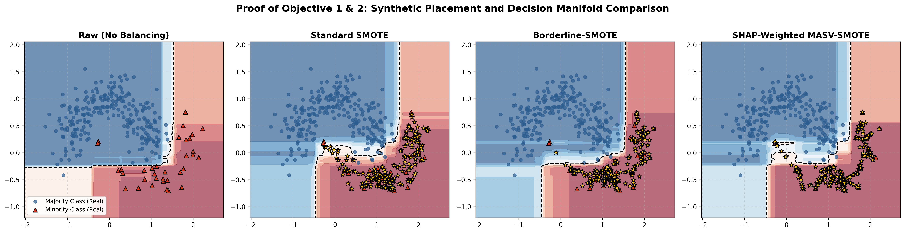

# 01 — The Problem, Real-World Failures, and What's New

> **Speaker goal:** in about 4 minutes, make the panel feel *why this matters* before any maths.
> Order: the problem → 3 or 4 real failures → what they have in common → what we do differently.

---

## 1. The problem in plain words

The events we most need to catch are the **rarest** ones: fraud, sepsis, network attacks,
machine failures, preterm births. In the data, they are the **minority class**, often less than
1% of rows.

A model trained on that data learns a lazy trick: **"always say no" is almost always right.**
On a fraud dataset with 0.17% fraud, a model that never flags fraud is **99.83% accurate**, and
completely useless.

The usual fix is **SMOTE**. It makes fake rare-class rows by picking a point on the line between
two real rare rows that are "close" to each other. It is in almost every tutorial and many real
systems.

**SMOTE has three blind spots, and our project targets each one:**

| # | Blind spot | What goes wrong | Where we fix it |
|---|---|---|---|
| 1 | **It treats every feature as equally important.** If 5 features matter and 25 are noise, the noise decides who is "close", so SMOTE pairs the wrong rows. | Fake rows land in the wrong place, and the model learns noise. | **Objective 2:** SHAP-guided SMOTE |
| 2 | **It's easy to use in the wrong place.** If you make fake rows *before* splitting into train and test, copies of test rows leak into training. | Scores look near-perfect on paper, then the model fails in real use. | **Objective 3:** a leak-free test setup, plus proof of the trap |
| 3 | **People judge it with the wrong score.** Accuracy (and even ROC-AUC) hides how badly the rare class is handled. Few people check whether probabilities are honest or explanations are stable. | Over-confident models whose explanations change every time they're retrained. | **Objective 4:** several scores, not one |

---

## 2. Real-world case studies

All of these are public and documented. Each one maps to a blind spot above. Sources are at the
bottom. **Read the source before quoting a number on stage.**

### Case 1: The "near-perfect" preterm-birth models (the leakage trap)
*Blind spot 2 → Objective 3*

- **What happened:** a public dataset of 300 pregnancy recordings has only 38 preterm births.
  Many published studies reported **near-perfect** accuracy at predicting preterm birth from it.
- **The flaw:** Vandewiele et al. (*Artificial Intelligence in Medicine*, 2021) re-ran 11 of these
  studies. The near-perfect results only appeared when oversampling was done on the **whole
  dataset before** splitting it. Fake rows built from test patients ended up in training, so the
  model was tested on data it had already seen.
- **Coverage:** *The Register* reported that 11 of 24 papers examined mixed training and test data.
- **Why it matters to us:** our pipeline is built so this mistake **can't happen**. Oversampling,
  scaling and SHAP all run inside the training data only.

> **Slide one-liner:** *"Eleven medical papers reported near-perfect results. Fix the order of the
> steps and the near-perfect scores disappear. Our pipeline can't make that mistake."*

### Case 2: Leakage is everywhere, not a one-off
*Blind spot 2 → Objective 3*

- Kapoor & Narayanan (Princeton, *Patterns*, 2023) found **data leakage in 294 papers across 17
  fields**, and sorted it into 8 types.
- In one of their examples (predicting civil wars), the claimed advantage of machine learning over
  older methods **disappeared once the leakage was fixed**.
- **Why it matters to us:** "preparing the data on train and test together" is one of their
  named leakage types, and oversampling is the most common way it happens with rare-event data.

### Case 3: The Epic sepsis model (a rare event in hundreds of hospitals)
*Blind spots 1 and 3 → Objective 4*

- **What happened:** Epic's sepsis-warning model was used in hundreds of US hospitals. Wong et al.
  (University of Michigan, *JAMA Internal Medicine*, 2021) tested it on **38,455 hospital stays**.
- **Findings:** ROC-AUC was **0.63**, far below what the developer reported. An editorial reported
  **33% sensitivity** and **12% positive predictive value**. In plain words, it missed about
  two-thirds of sepsis cases (our arithmetic from the 33%), and most of its alarms were false. It
  alerted on about **18% of all patients**, which causes alarm fatigue.
- **Caveat (say this if asked):** Epic disputed parts of the study, mainly how sepsis onset was defined.
- **Why it matters to us:** a rare-event model judged by the wrong score. That's why we report
  **PR-AUC, recall, precision and calibration**, not just accuracy or ROC-AUC.

### Case 4: The Dutch childcare-benefits scandal (a fraud model nobody could inspect)
*Blind spot 3 → the reason explainability matters*

- **What happened:** the Dutch tax authority used a self-learning **risk model** (from 2013) to
  flag childcare-benefit fraud. **More than 20,000 parents** (some sources say more than 25,000)
  were wrongly treated as fraudsters, and many were pushed into serious debt.
- The model used **"Dutch nationality: yes/no"** as a risk factor. The Dutch data-protection
  authority called this *unlawful and discriminatory* and fined the tax authority **€2.75M**
  (December 2021).
- **Outcome:** Prime Minister Rutte's government **resigned in January 2021**.
- **Why it matters to us:** if feature importance (SHAP) had been a normal part of the pipeline, a
  nationality feature driving fraud scores would have been visible. We put SHAP **inside** the
  balancing step, and we measure whether its explanations are **stable** enough to trust.

### Case 5: Michigan MiDAS (fraud flags with no human check)
*Extra example, if there's time*

- Michigan's automated unemployment-fraud system (MiDAS) issued fraud findings from 2013 to 2015.
  The state later admitted **no human had to double-check them**, and heavy fines were applied
  automatically.
- The class action *Bauserman v. Unemployment Insurance Agency* settled for **$20 million**
  (announced October 2022, final approval January 2024).
- **Takeaway:** when rare-event detectors are wrong at scale, real people pay. Honest probabilities
  and explanations are requirements, not extras.

### Case 6: COVID-19 diagnosis models (small, imbalanced, leaky datasets)
*Extra example: the methods are the bottleneck, not the algorithms*

- Roberts et al. (*Nature Machine Intelligence*, 2021) screened **2,212** studies on machine
  learning for COVID-19 diagnosis from chest scans. **62** passed quality screening, and **none**
  were judged fit for clinical use. The problems included tiny datasets, datasets mixed together
  from different sources, and results nobody could reproduce.

### How big the problem is
- **UK Finance Annual Fraud Report 2024:** **£1.17 billion** was stolen through fraud in the UK in
  2023 (£708.7M unauthorised and £459.7M authorised push-payment fraud). Banks also *prevented*
  £1.25bn of unauthorised fraud, and rare-event models do much of that work.
- **Regulators want explanations:**
  - **EU AI Act (2024):** credit scoring and access to public benefits count as *high-risk* AI,
    with duties to be transparent and document how decisions are made.
  - **US ECOA / Regulation B:** lenders must give the *specific* reasons for refusing credit. The
    CFPB's Circular 2022-03 said "the algorithm is too complex" is no excuse. *(Note: that circular
    was withdrawn in May 2025. The underlying duty to give specific reasons still exists.)*

---

## 3. What all of these failures have in common

```
 Rare event ──► Imbalanced data ──► Rebalancing (e.g. SMOTE) ──► Model ──► Decision about a person
                                          │                         │
                      (a) done before the split → LEAKAGE    (c) no stable explanation
                      (b) ignores which features matter      (d) judged on accuracy only
```

| What went wrong | Seen in | What we do about it |
|---|---|---|
| (a) Leakage from balancing before splitting | Preterm births, Kapoor & Narayanan, COVID-19 | `LeakFreePipeline`: scaling, SHAP and oversampling only ever see training data |
| (b) Fake data that ignores which features matter | The general SMOTE weakness | SHAP-Filtered SMOTE and SHAP-Weighted SMOTE |
| (c) Black-box, unstable explanations | Dutch benefits, Epic, MiDAS | SHAP built into balancing, plus a stability score |
| (d) The wrong score hides rare-case failure | Epic sepsis | PR-AUC, recall, precision, F1, calibration |

---

## 4. Our idea and what's new

### The one-sentence pitch
> **We use SHAP, the standard tool for *explaining* models, to *guide* how SMOTE makes fake
> rare-class rows, and we test it in a setup where data leakage can't happen.**

### The shift

**How people use SHAP today:** after the model is trained, to explain it.
```
[Imbalanced data] → [SMOTE] → [Train model] → [SHAP explains the model]   ← too late to help
```

**How we use SHAP:** before the model, to shape the training data.
```
[Training data] → [Small scout model] → [SHAP scores] → [One importance weight per feature]
                                                              │
                          ┌───────────────────────────────────┴───────────────────────┐
                          ▼                                                           ▼
               SHAP-Filtered SMOTE                                       SHAP-Weighted SMOTE
     (ignore unimportant features when                         (let each feature count in proportion
      looking for neighbours)                                   to its importance)
                          └───────────────────────────────────┬───────────────────────┘
                                                              ▼
                                  Better fake rare-class rows → final model
```



*Red triangles = real rare rows, yellow stars = fake rows, blue = the common class. Compare where
the yellow stars spread in the "Standard SMOTE" panel and in the "SHAP-Weighted" panel.*

### What exactly is new

1. **SHAP as a guide for making data, not just an explanation.** Most work stops at "SHAP explains
   the model". We feed SHAP's answers back into how the training data is built.
   *(Honesty note: one earlier study, on network attack detection (ITS 2023), tried SHAP-weighted
   SMOTE on one dataset. We don't claim the first idea. We claim the first **careful, leak-free,
   multi-score** test of it, plus a second version.)*
2. **Two versions of one idea.** *Filtered* (keep only the features that matter) vs *Weighted*
   (every feature counts, in proportion to its importance). Comparing them tells us *how* SHAP
   should guide balancing. See [10](10_shap_filtered_smote_deep_dive.md) for the Filtered version in depth.
3. **SHAP itself can leak, and we stop it.** SHAP is learned from data. If it's computed on the
   whole dataset, test data leaks into the feature weights. We compute SHAP **inside each training
   fold**. Many careful papers miss this.
4. **Four scores instead of one.** Catching rare cases, honest probabilities, realistic fake data,
   and **stable explanations** (does the model keep saying the same features matter each time it
   is retrained?). Most oversampling papers never check that last one.
5. **A map of where explainability can plug in (Objective 1):** after the model, before balancing,
   during balancing, and after the fake rows are made. It places our two methods among the others.

### Why SHAP weights and not something else? (expect this question)

| Alternative | Why it falls short |
|---|---|
| Plain SMOTE, Borderline-SMOTE, ADASYN | They all treat every feature equally, so they can't tell signal from noise |
| Mahalanobis distance (a statistical weighted distance) | Needs a matrix inversion that breaks when there are fewer rare rows than features, which is common. SHAP weights need no inversion. |
| GANs, VAEs, diffusion models (AI generators like CTGAN, TVAE, TabDDPM) | Need lots of rare examples (we often have under 100), are hard to tune, and are black boxes |
| Class weights or focal loss | They change how much mistakes cost, but don't add new rare examples. They could be added as extra baselines. |

### Why now?
- Regulators increasingly require **explainable** high-risk decisions. A balancing method that is
  *driven by* explanations is easier to justify.
- The reproducibility crisis (Cases 1, 2 and 6) shows that a **trustworthy test setup** is a
  research contribution in its own right.
- SHAP's TreeExplainer is fast enough to run in every fold, so the method is practical.

---

## Sources

- Vandewiele et al., *Overly optimistic prediction results on imbalanced data…*, Artificial Intelligence in Medicine 111 (2021), [arXiv:2001.06296](https://arxiv.org/abs/2001.06296); press: [The Register, Jan 2020](https://www.theregister.com/2020/01/24/ai_models_data/)
- Kapoor & Narayanan, *Leakage and the reproducibility crisis in ML-based science*, Patterns (2023): [PMC10499856](https://pmc.ncbi.nlm.nih.gov/articles/PMC10499856); [Princeton summary](https://reproducible.cs.princeton.edu/)
- Wong et al., *External validation of a widely implemented proprietary sepsis prediction model*, JAMA Intern Med (2021): [JAMA](https://jamanetwork.com/journals/jamainternalmedicine/fullarticle/2781313); [Michigan Medicine summary](https://michiganmedicine.org/health-lab/popular-sepsis-prediction-tool-less-accurate-claimed)
- Dutch childcare-benefits scandal: [Oxford Human Rights Hub](https://ohrh.law.ox.ac.uk/algorithms-and-the-best-interests-of-the-child-lessons-from-the-dutch-childcare-scandal/); [AI Incident Database](https://incidentdatabase.ai/ja/reports/1863)
- Michigan MiDAS settlement: [Bridge Michigan](https://bridgemi.com/?p=1906); [U-M Ford School brief](https://stpp.fordschool.umich.edu/research/policy-brief/case-over-michigan-unemployment-insurance-agencys-faulty-automated-system)
- Roberts et al., *Common pitfalls… ML to detect and prognosticate for COVID-19*, Nature Machine Intelligence (2021): [Cambridge news](https://www.cam.ac.uk/research/news/machine-learning-models-for-diagnosing-covid-19-are-not-yet-suitable-for-clinical-use)
- UK Finance Annual Fraud Report 2024: [Finextra coverage](https://finextra.com/newsarticle/44186); [Crowdfund Insider](https://www.crowdfundinsider.com/2024/05/225420-fraud-remains-major-problem-as-over-1-billion-is-stolen-by-criminals-in-2023-uk-finance-report/)
- CFPB Circular 2022-03 (withdrawn May 2025): [Greenberg Traurig summary](https://www.gtlaw.com/en/insights/2022/6/cfpb-circular-2022-03-complex-lending-algorithms-adverse-credit-determination)
