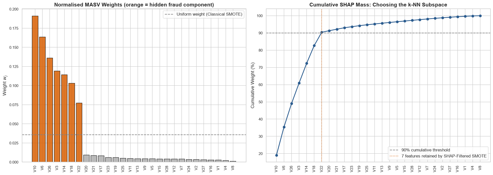
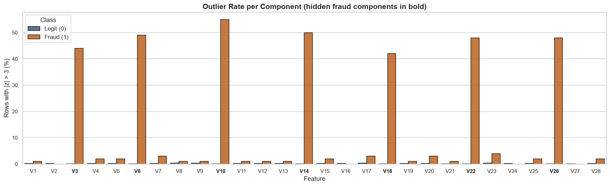

# 02 — How the System Works

> **Speaker goal:** explain each building block in plain words, then show how they fit together.
> Think of it like a factory line: each machine has one job, and the product (a fair score)
> comes out at the end.

---

## 1. The big picture

```
                        ┌──────────────────── YOUR DATA (rows X, labels y) ────────────────────┐
                        │                                                                      │
                        ▼                Split into 5 parts ("folds"), keeping                  ▼
              ┌──────────────────┐       the same rare-class share in each              ┌──────────────────┐
              │  TRAINING PART   │                                                      │    TEST PART     │
              └────────┬─────────┘                                                      │ (locked away     │
                       │                                                                │  until scoring)  │
     ┌─────────────────┼──────────────── LeakFreePipeline.fit() ─────────────────┐     └────────┬─────────┘
     │                 ▼                                                          │              │
     │  ① Scale the numbers (StandardScaler), learned on training rows only  ─────┼─ apply ──────┤
     │                 │                                                          │              │
     │                 ▼                                                          │              │
     │  ② Make fake rare rows (the oversampler)                                   │              │
     │       ├─ small scout model → SHAP → one importance weight per feature      │              │
     │       ├─ SHAP-Filtered: keep only the top features to find neighbours      │              │
     │       │  or SHAP-Weighted: stretch each feature by its importance          │              │
     │       └─ build the new rows using all features                             │              │
     │                 │                                                          │              │
     │                 ▼                                                          │              │
     │  ③ Train the final model on the now-balanced training rows  ───────────────┼─ predict ────┤
     └────────────────────────────────────────────────────────────────────────────┘              │
                                                                                                  ▼
                                       ④ Score the model on the untouched test part
                                          (PR-AUC, recall, precision, F1, calibration…)
                                                                                                  │
                                       ⑤ Ask SHAP which features this fold's model relied on
                                                                                                  │
                                                       repeat for every fold ▼
                                       ⑥ Average the scores, and check whether the
                                          important features stay the same across folds
```

**The golden rule:** anything that *learns* from data (the scaler, SHAP, the oversampler, the
model) learns from the **training part only**. The test part is used once, for scoring.

---

## 2. The parts, one by one

### 2.1 `compute_masv_weights`: the "which features matter?" engine
**File:** [src/oversampling/base.py](../src/oversampling/base.py)

**Job:** answer "which features actually help tell the rare class from the common one?"

1. Train a **small scout model** (Random Forest, 50 trees, depth 5) on the training rows. It is a
   quick helper, not the final model.
2. Run **SHAP** on it. For every row and every feature, SHAP says how much that feature pushed the
   prediction up or down.
3. For each feature, average those amounts, ignoring the +/− sign. This is the **MASV** (Mean
   Absolute SHAP Value). Big number = the feature matters a lot.
4. Divide by the total so all the weights add up to 1, like percentages.
5. Safety nets: if SHAP fails, a more general SHAP method is used. If every score comes back as
   zero, every feature gets the same weight (which is just plain SMOTE).

> **Plain-English version:** *"Before making fake fraud cases, we ask a quick model which
> features it actually uses to spot fraud, and we turn that into one importance score per feature."*



*Credit fraud example: out of 28 features, the 7 real fraud features (orange) get 90% of the
importance. Plain SMOTE would give every feature the same share (dashed line).*

### 2.2 `SHAPBaseOversampler`: shared plumbing
**File:** [src/oversampling/base.py](../src/oversampling/base.py)

- Checks there are exactly **two classes** and works out which one is rare.
- Decides **how many fake rows** to make:
  - `"auto"`: make enough to match the common class (1:1).
  - a number like `0.5`: make the rare class half the size of the common class.

### 2.3 `SHAPFilteredSMOTE`: the "mute button" version
**File:** [src/oversampling/shap_filtered_smote.py](../src/oversampling/shap_filtered_smote.py)
**Deep dive:** [10_shap_filtered_smote_deep_dive.md](10_shap_filtered_smote_deep_dive.md)

1. Get the SHAP importance weights.
2. Keep only the top features, chosen in one of three ways:
   - `top_k`: keep exactly *k* features
   - `top_ratio`: keep the top x% of features
   - `cumulative_threshold` (default **0.90**): keep features until they cover 90% of the importance
3. For each rare row, find its nearest rare neighbours **using only the kept features**.
4. Make each new row as normal SMOTE does: a random point on the line between a row and one of its
   neighbours. **All columns are used here**, so nothing is lost.
5. Add the new rows to the original data.

### 2.4 `SHAPWeightedSMOTE`: the "volume dial" version
**File:** [src/oversampling/shap_weighted_smote.py](../src/oversampling/shap_weighted_smote.py)

1. Get the SHAP importance weights `w`.
2. Stretch every feature by `√w`. Important features are stretched a lot, noise features are
   squashed. A normal distance measured on the stretched data then counts each feature in
   proportion to its importance.
3. Find nearest neighbours in that stretched space.
4. Build the new rows from the **original, unstretched** values, so they look like real data.

> **Filtered vs Weighted in one line:** Filtered is a **mute button** (a feature counts or it
> doesn't). Weighted is a **volume dial** (each feature counts more or less).

### 2.5 Baselines: the competition
**File:** [src/oversampling/baselines.py](../src/oversampling/baselines.py)

| Name | What it does | Why it's in the test |
|---|---|---|
| `raw` | No balancing | Shows how bad the imbalance is on its own |
| `ros` | Copies existing rare rows | The simplest fix, and it tends to memorise |
| `smote` | Standard SMOTE | Our main opponent |
| `borderline_smote` | SMOTE, only near the class border | A popular variant |
| `adasyn` | More fake rows where the rare class is hardest to learn | A popular variant |
| `smote_enn` | SMOTE, then remove messy rows | A "make then clean" method |
| `smote_tomek` | SMOTE, then remove overlapping pairs | A "make then clean" method |

All except `raw` and `ros` come from **imbalanced-learn**, the standard library, so nobody can say
we weakened the opponents.

### 2.6 `LeakFreePipeline`: the leak-proof container
**File:** [src/pipeline/leak_free_cv.py](../src/pipeline/leak_free_cv.py)

It wraps three steps: **scale → make fake rows → train the model**.
- `fit(train)`: learns the scaling from training rows, makes fake rows (this is where SHAP runs),
  then trains the model.
- `predict(test)`: applies the *training* scaling to the test rows and predicts. The test rows
  never go through `fit`.

Because the fake rows are made inside `fit`, they **can't** be built from test rows.

### 2.7 `run_leak_free_benchmark` and `run_benchmark.py`: the experiment runners
**Files:** [src/pipeline/leak_free_cv.py](../src/pipeline/leak_free_cv.py), [experiments/run_benchmark.py](../experiments/run_benchmark.py)

1. Split the data into folds that each keep the real rare-class share ("stratified").
2. For each fold: build a `LeakFreePipeline`, train on the training part, score on the test part.
3. Run SHAP on that fold's final model to see which features it relied on.
4. Average every score over the folds, and measure how similar the feature rankings are between
   folds (the **stability** score).

`run_benchmark.py` does this for every dataset × oversampler × model listed in
[experiments/configs/benchmark_default.yaml](../experiments/configs/benchmark_default.yaml), then
saves tables (CSV, JSON, LaTeX) and charts to [experiments/results/](../experiments/results/).

### 2.8 The scoreboard
**Files:** [src/evaluation/metrics.py](../src/evaluation/metrics.py), [fidelity.py](../src/evaluation/fidelity.py), [stability.py](../src/evaluation/stability.py)

| Group | Scores | Question it answers |
|---|---|---|
| Catching rare cases | PR-AUC (main score), ROC-AUC, recall, precision, F1, balanced accuracy, G-mean | Do we catch the rare cases without drowning in false alarms? |
| Honest probabilities | ECE, Brier score | When the model says "80% fraud", is it right about 80% of the time? |
| Realistic fake data | Wasserstein distance, KS test pass rate, correlation similarity | Do the fake rows look like real rare rows? |
| Stable explanations | Kendall τ, Spearman ρ | Does the model name the same important features every time it's retrained? |

### 2.9 Datasets and models
**Main benchmark** ([src/experiment/data.py](../src/experiment/data.py), files in [data/](../data/README.md)): four **real** datasets.

| Dataset | Type | Rows | Imbalance |
|---|---|---|---|
| Breast Cancer Wisconsin | Real medical data (tumour measurements) | 396 | 9.2 : 1 |
| Credit Card Fraud (ULB) | Real card transactions | 275,663 | 582 : 1 |
| Stroke Prediction | Real patient records, numbers + categories | 5,110 | 19.5 : 1 |
| NSL-KDD | Real network connections, numbers + categories | 73,199 | 11.5 : 1 |

Models: Logistic Regression, Random Forest, XGBoost (same settings for every method and dataset).

**Earlier benchmark** ([src/pipeline/datasets.py](../src/pipeline/datasets.py)): a made-up dataset, Breast Cancer,
*simulated* credit-card fraud and network data, and Stroke; models also included LightGBM and Gradient Boosting.

### 2.10 The four-dataset experiment (the main results)
**Files:** [src/experiment/](../src/experiment/) and notebooks `01`–`05`

One shared set of building blocks, used identically by the four dataset notebooks:

| Block | File | Job |
|---|---|---|
| Settings | `config.py` | Every setting in one place (seed, test size, folds, k, thresholds, models) |
| Data | `data.py` | Loads each dataset and reports its quality |
| Preparation | `preprocessing.py` | Fills missing values, turns categories into 0/1 columns, scales numbers, all learned from training rows only |
| Runner | `runner.py` | 10 leak-free cross-validation rounds + the final test on the locked 25% |
| Inspection | `inspection.py` | Neighbour tables, the "birth certificate" of every fake row, SHAP's reasoning, fake-row quality |
| Charts, saving, summaries | `plots.py`, `outputs.py`, `summary.py` | All figures and tables, saved to `results/<dataset>/` |

The oversamplers all share one engine ([src/oversampling/provenance.py](../src/oversampling/provenance.py)) that
records, for every fake row, its two parent rows, the neighbour rank and λ. Notebook cell by cell:
[11](11_notebook_walkthrough_cell_by_cell.md).

---

## 3. A worked example (one fold of the *simulated* credit fraud data)

From [notebooks/archive/02_credit_fraud_shap_smote_walkthrough.ipynb](../notebooks/archive/02_credit_fraud_shap_smote_walkthrough.ipynb):

1. **Split:** 5,000 transactions → 3,750 for training (75 fraud), 1,250 for testing (25 fraud).
   The test rows are locked away.
2. **Clean:** check for missing values, duplicates and broken numbers. None were found. Unusual
   values ("outliers") are **kept**, because in fraud data the outliers *are* the fraud.
3. **Scale:** the scaler learns averages and spreads from the 3,750 training rows only.
4. **SHAP:** the scout model trains on those rows. SHAP gives 28 importance weights, and the 7 real
   fraud features get 90% of the total.
5. **Make fake rows:** 3,600 fake fraud rows are made, so training is now 3,675 fraud vs 3,675 normal.
   - *Filtered:* finds neighbours using only the 7 top features.
   - *Weighted:* uses all 28, but the 7 top features count about 2× more and the noise about 0.35×.
6. **Train:** k-NN or Random Forest on the 7,350 balanced rows.
7. **Score:** predict on the 1,250 untouched test rows, which still have only 2% fraud.
8. **Repeat** for all folds, then average.



*Why we don't delete outliers: nearly all the unusual values sit on the fraud rows (orange), on
exactly the features that carry the fraud signal.*

---

## 4. Code map (who owns what)

```
src/
├── oversampling/                 ← Objective 2
│   ├── base.py                   compute_masv_weights, SHAPBaseOversampler
│   ├── shap_filtered_smote.py    SHAPFilteredSMOTE  (mute button)
│   ├── shap_weighted_smote.py    SHAPWeightedSMOTE  (volume dial)
│   ├── classical.py, hybrids.py  SMOTE, Borderline, ADASYN, SMOTE-ENN, SMOTE-Tomek wrappers
│   └── baselines.py              one place to create any baseline by name
│   └── provenance.py             shared engine: records the parents and λ of every fake row; SMOTE, Borderline, ROS
├── experiment/                   ← Objectives 3 + 4, the four-dataset benchmark
│   ├── config.py, data.py, preprocessing.py, runner.py
│   └── inspection.py, plots.py, outputs.py, summary.py
├── pipeline/                     ← earlier benchmark
│   ├── leak_free_cv.py           LeakFreePipeline, run_leak_free_benchmark
│   ├── cross_validator.py        runner with timing
│   ├── datasets.py               the earlier datasets (incl. simulations)
│   └── models.py                 LogReg, RF, XGBoost, LightGBM, Gradient Boosting
└── evaluation/                   ← Objective 4
    ├── metrics.py                catching rare cases + honest probabilities
    ├── fidelity.py               realistic fake data
    ├── stability.py              stable explanations
    └── visualization.py          charts and LaTeX tables
experiments/run_benchmark.py      earlier benchmark (reads a YAML config)
notebooks/                        01–04 = one experiment per dataset, 05 = cross-dataset comparison,
                                  archive/ = earlier credit-fraud walkthrough (simulated data)
results/<dataset>/                everything the notebooks save (metrics, fake rows, neighbours, charts)
docs/literature/                  ← Objective 1 (literature review, comparison table, notes)
tests/                            34 tests, including the automatic leakage test
```
