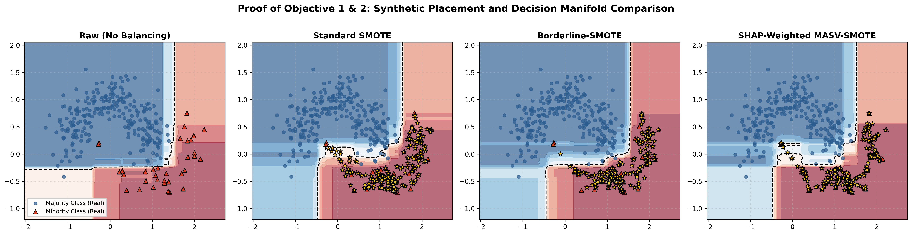
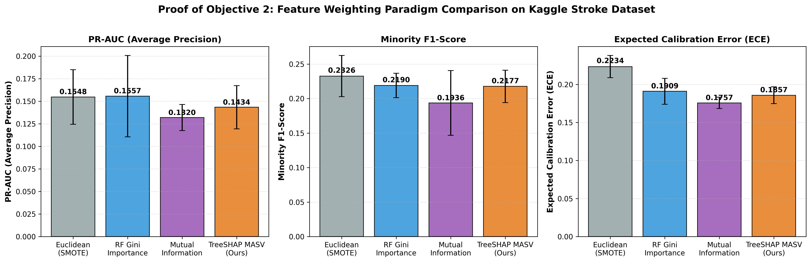

# Objective 1 — What Already Exists, Where It Breaks, and Where SHAP Fits

> **Presenter:** ______  **Time:** ~3 min
> **Status:** ✅ Done. The documents are in [docs/literature/](../docs/literature/).
> **Research question (RQ1):** *Why do SMOTE-style methods struggle, and where in the balancing
> process can explainability (SHAP) be plugged in?*

---

## 1. What this objective is

Before building anything, we had to show we know **what already exists, where it fails, and
exactly where our idea fits**. Objective 1 does that in three documents:

| Document | File | What's inside |
|---|---|---|
| Literature review | [slr_imbalanced_learning.md](../docs/literature/slr_imbalanced_learning.md) | Why models fail on rare classes, how each SMOTE variant works and fails, how SHAP works, and our 4-point map |
| Comparison table | [taxonomy_matrix.md](../docs/literature/taxonomy_matrix.md) | 11 oversampling methods side by side, plus a comparison of ways to measure distance |
| Reading notes | [reading_notes.md](../docs/literature/reading_notes.md) | Notes on the key papers and the gaps we fill |

---

## 2. Key ideas to explain

### 2.1 Why models fail on rare classes
- **Imbalance ratio** = common rows ÷ rare rows. Mild is 2–10, moderate is 10–100, extreme is over
  100 (real credit-card fraud is about 580).
- At a ratio of 100, a model that always says "common class" is **99%** accurate.
- Three reasons it happens:
  1. **The boundary drifts.** The line between the classes moves into rare-class territory.
  2. **Common-class mistakes dominate training.** There are simply far more of them.
  3. **Trees ignore a few rare rows.** A split isn't "worth it" for a handful of points.
- **The ratio isn't the whole story.** The rare class may be split into tiny clumps, may overlap
  the common class, or may contain noisy rows. All of these make things harder.

### 2.2 The oversampling family tree (and where each one breaks)

| Family | Methods | Weak spot |
|---|---|---|
| Copying | Random oversampling | Pure copies, so the model memorises them |
| Classic | **SMOTE** | Treats every feature equally, so noise decides who is "close" |
| Border-focused | Borderline-SMOTE | A fragile "danger zone" rule, and it still treats features equally |
| Difficulty-focused | ADASYN | Ends up putting the *most* fake rows around *noisy* rows |
| Cluster-based | K-Means SMOTE, G-SMOTE | Extra settings to tune, and features still count equally |
| Make then clean | SMOTE-ENN, SMOTE-Tomek | Cleaning happens afterwards, but the fake rows are still made blindly |
| AI generators | CTGAN, TVAE, TabDDPM | Need lots of data, break with fewer than 100 rare rows, and are black boxes |
| **SHAP-guided (ours)** | **SHAP-Filtered, SHAP-Weighted** | Needs an extra scout model and SHAP step (modest cost) |

> **The punchline:** *every classic method in this table measures "close" the same way, with
> every feature counting equally. None of them asks which features matter.*

### 2.3 Why "every feature counts equally" hurts, with numbers
If **5 features carry signal and 25 are noise**, then about **25 / 30 ≈ 83%** of the distance
between two rows comes from noise. So "nearest neighbours" are picked mostly by noise, and SMOTE
connects the wrong rows.

You can see the effect in this picture. Yellow stars are fake rows. Compare how far they spread
into the blue (common-class) area in each panel:



### 2.4 Three ways to measure "close"

| Method | In plain words | Problem |
|---|---|---|
| Euclidean (used by SMOTE) | Straight-line distance, every feature counts equally | Noise counts as much as signal |
| Mahalanobis | Adjusts for how features vary together | Needs a matrix inversion that breaks when there are fewer rare rows than features |
| **SHAP-weighted (ours)** | Each feature counts by its SHAP importance | No inversion needed, and noise gets a weight close to 0 |

We also compared SHAP weights against two other ways of scoring importance (Random Forest's
built-in importance, and mutual information) on the Kaggle stroke data:



**Honest reading:** on the stroke data the four ways land close together. SHAP's PR-AUC (0.143)
is a little *below* plain SMOTE (0.155), and its calibration error (0.186) is better than plain
SMOTE (0.223). There is no clear winner on this dataset.

### 2.5 SHAP in 60 seconds
- Based on **Shapley values** from game theory (1953). Think of the features as players on a team
  and the prediction as the prize. Shapley values share the prize fairly according to each
  player's contribution.
- Lundberg & Lee (NeurIPS 2017) proved it is the **only** method of its kind with a set of
  sensible fairness rules.
- **TreeSHAP** computes exact values quickly for tree models. That's why we can afford to run it
  in every fold.
- **MASV** (the average size of a feature's SHAP values) gives one importance number per feature.
  Unlike Random Forest's built-in importance, it isn't biased toward features with many distinct values.

### 2.6 Our main idea: four places SHAP can plug in

```
 [Raw data] ──T2──► [Balancing] ──T3──► [Fake rows] ──T4──► [Model] ──T1──► [Checking]
```

| Point | Where SHAP acts | What it does | In this project |
|---|---|---|---|
| **T1 After the model** | After training | Explains the finished model, *doesn't change the data* | What everyone does today, plus our stability score |
| **T2 Before balancing** | Before neighbours are found | Drops unimportant features from the neighbour search | **SHAP-Filtered SMOTE** ([10](10_shap_filtered_smote_deep_dive.md)) |
| **T3 During balancing** | Inside the distance measure | Gives each feature a say in proportion to its importance | **SHAP-Weighted SMOTE** |
| **T4 After making fake rows** | After the fake rows exist | Rejects fake rows with strange SHAP patterns | Future work |

> **What to say:** *"Almost everyone uses SHAP at T1, after the model is trained, when it can only
> describe problems. Our map shows three earlier places where it could actually fix them. We build
> and test T2 and T3."*

---

## 3. Gaps in the literature, and which objective fills each

| Gap found in the review | Filled by |
|---|---|
| The SMOTE family assumes every feature matters equally | **Objective 2:** SHAP-guided neighbour search |
| Explainability is only used after training | **Objective 2:** SHAP inside balancing |
| The earlier SHAP-weighted SMOTE study (network attacks, ITS 2023) used one dataset, didn't check stability or calibration, and risked leakage | **Objectives 3 and 4:** several datasets, no leakage, several scores |
| Accuracy and ROC-AUC used for rare events (Saito & Rehmsmeier 2015 show PR-AUC is more informative) | **Objective 4:** PR-AUC as the main score |
| Leakage in published results (Vandewiele 2021; Kapoor & Narayanan 2023) | **Objective 3:** leak-free pipeline and proof of the trap |

**Be honest about earlier work.** SHAP-weighted SMOTE has been tried before (the ITS
network-attack paper). Our contribution is not "the first to think of it". It is (a) setting out
**two** versions inside one map, and (b) the **first leak-free, multi-dataset, multi-score** test of
them, including explanation stability.

---

## 4. Core reading list (for questions)

1. Chawla et al. (2002). *SMOTE.* JAIR 16.
2. He & Garcia (2009). *Learning from Imbalanced Data.* IEEE TKDE 21(9).
3. Fernández, García, Herrera & Chawla (2018). *SMOTE… 15-year anniversary.* Information Sciences.
4. Han et al. (2005). *Borderline-SMOTE.* He et al. (2008). *ADASYN.* Batista et al. (2004). *SMOTE-ENN / Tomek.*
5. Saito & Rehmsmeier (2015). *The PR plot is more informative than ROC on imbalanced data.* PLoS ONE.
6. Lundberg & Lee (2017). *A Unified Approach to Interpreting Model Predictions.* NeurIPS.
7. SHAP-based feature selection and MASV-weighted SMOTE for intrusion detection (ITS, 2023).

---

## 5. Likely questions

- **"Why a full literature review and not just a background section?"** Because the 4-point map is
  a contribution in itself. It shows all the options (T1–T4) and why T2 and T3 are the untested middle.
- **"Why not AI generators like GANs?"** With fewer than 100 rare rows they break down or memorise,
  they're expensive to tune, and nobody can see why they made a given row. Our methods work with as
  few as 2 rare rows.
- **"Is MASV a good importance measure?"** It rests on solid theory (the Shapley fairness rules). Its
  limit is that averaging hides *direction* and *combinations* of features. We list that as a limitation.
