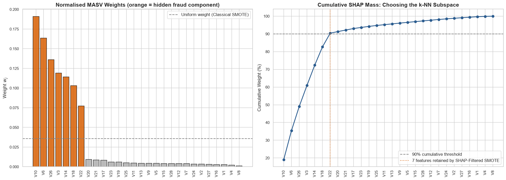
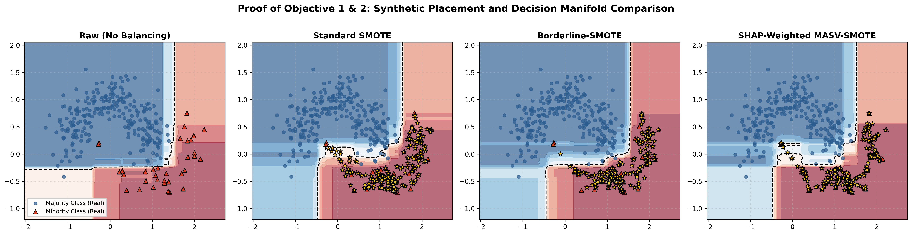
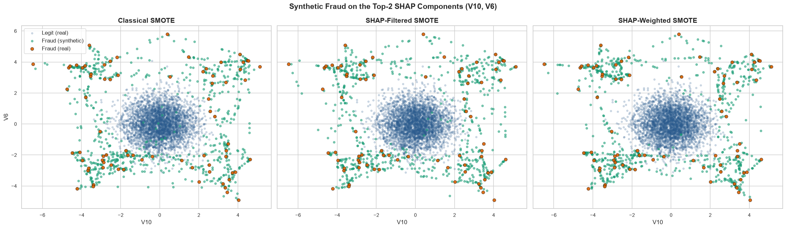
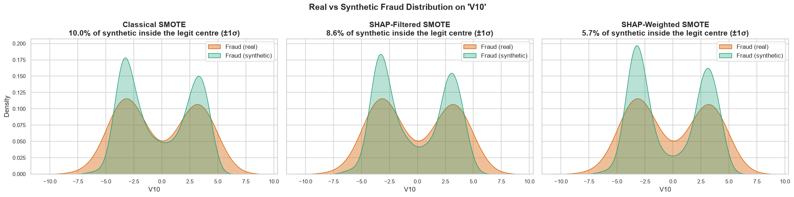

# Objective 2 — Our Two Methods: SHAP-Filtered and SHAP-Weighted SMOTE

> **Presenter:** ______  **Time:** ~4 min
> **Status:** ✅ Built, tested and benchmarked on four real datasets. Code is in [src/oversampling/](../src/oversampling/);
> the maths as implemented is in [docs/methodology_shap_guided_smote.md](../docs/methodology_shap_guided_smote.md);
> results: [16](16_cross_dataset_notebook.md).
> **Research question (RQ2):** *How can SHAP's "which features matter" scores be used to make SMOTE
> build better fake rows, and how do the two ways of doing it behave?*
> **Deep dive on the Filtered version:** [10_shap_filtered_smote_deep_dive.md](10_shap_filtered_smote_deep_dive.md)

---

## 1. What this objective is

SMOTE makes new fake rows for the rare class so the model sees enough examples of it. Our idea is
to let **SHAP** tell SMOTE which features actually matter, so the fake rows are built from better
information.

We built this in **two versions** and made sure they can be compared fairly against **seven
standard methods** (the "baselines").

**Key words:**
- **Rare class (minority)** = the uncommon one, e.g. fraud. **Common class (majority)** = everything else.
- **Oversampling** = adding more rare rows so both classes are a similar size.
- **SHAP** = a tool that scores how much each feature contributed to a model's prediction.

---

## 2. What plain SMOTE does

To make one fake row:
1. Take a real rare row, and find the *k* rare rows most similar to it (its **neighbours**).
   "Similar" means a short straight-line distance, with **every feature counting equally**.
2. Pick one of those neighbours at random.
3. Draw a line between the two rows and pick a random point on it. That point is the new fake row.

```
   neighbour ●
              \
               ✕  ← new fake row, somewhere on the line
                \
                 ● original rare row
```

**The weak link is step 1.** If many features are noise, the noise decides who counts as a
neighbour. SMOTE then connects the wrong rows, and every fake row built from them is wrong too.

**Both of our versions change only step 1.** Steps 2 and 3 are exactly the same as normal SMOTE.
So if the results change, we know it's because of the better neighbour choice and nothing else.

---

## 3. The shared first step: one importance score per feature

**Function:** `compute_masv_weights(X, y)` in [base.py](../src/oversampling/base.py)

Before making any fake rows, using the **training data only**:

1. **Train a small scout model** (Random Forest, 50 trees, depth 5). Its only job is to tell us
   which features matter.
2. **Run SHAP on it.** For every row, SHAP says how much each feature pushed the prediction.
3. **Average per feature**, ignoring the +/− sign. This is the **MASV** (Mean Absolute SHAP Value).
4. **Turn it into percentages:** divide each score by the total, so they add up to 1.
   A feature with weight 0.30 accounts for 30% of the importance.

In formula form: `MASV_j = average of |SHAP value of feature j|`, then `w_j = MASV_j / sum of all MASV`.



*On the credit fraud simulation, SHAP finds all 7 real fraud features (orange) out of 28, and gives
them 90% of the importance. It was never told which features were real.*

**Why these choices:**

| Choice | Why |
|---|---|
| Random Forest as the scout | Fast, handles complex patterns, and SHAP is exact and quick for tree models |
| Small (depth 5, 50 trees) | Cheap, and a small model is less likely to memorise the few rare rows |
| Ignore the +/− sign | We care *how much* a feature matters, not which direction it pushes |
| SHAP values for the **rare class** | We want the features that identify the rare class |
| Fallback: equal weights | If SHAP returns all zeros, every feature gets the same weight, which is plain SMOTE |

---

## 4. Version A: SHAP-Filtered SMOTE (the "mute button")

**Class:** `SHAPFilteredSMOTE` in [shap_filtered_smote.py](../src/oversampling/shap_filtered_smote.py)

**Idea:** use only the most important features when looking for neighbours. The rest are
completely ignored during the search.

1. Sort the features from most to least important.
2. Keep features until they cover **90%** of the total importance (the default). You can also keep
   exactly the top *k* (`top_k`) or the top x% (`top_ratio`).
3. Find neighbours using only those kept features.
4. Build the new row with **all** features, as normal SMOTE does.

On the credit fraud data, this keeps exactly the 7 real fraud features and ignores the 21 noise ones.

- **Becomes plain SMOTE when:** the threshold is 100%, because then every feature is kept.
- **Strength:** removes noise from the neighbour search completely.
- **Risk:** a feature that looks weak on its own but matters **in combination** with others can be cut.

Everything about this version, including its benchmark results, is in [10](10_shap_filtered_smote_deep_dive.md).

---

## 5. Version B: SHAP-Weighted SMOTE (the "volume dial")

**Class:** `SHAPWeightedSMOTE` in [shap_weighted_smote.py](../src/oversampling/shap_weighted_smote.py)

**Idea:** keep every feature, but make important features count more when measuring "similar", and
unimportant ones count less.

The weighted distance is `d(a, b) = √( Σ  w_j × (a_j − b_j)² )`. It is the normal distance, except
each feature's difference is multiplied by its importance first.

**The trick that makes it fast:** multiply every column by `√w` (the square root of its weight).
The normal distance on these stretched columns is then exactly the weighted distance, because the
distance formula squares each difference, which turns √w back into w. So we can use
scikit-learn's standard, fast neighbour search without writing anything custom.

1. Get the weights `w`.
2. Stretch each column of the rare rows by `√w`.
3. Find neighbours in the stretched space.
4. Build new rows from the **original, unstretched** values, so they look like real data.

On the credit fraud data, the 7 real fraud features are stretched about **2×** and the noise
features are squashed to about **0.35×**.

- **Becomes plain SMOTE when:** all weights are equal. Every distance then shrinks by the same
  amount, so the nearest neighbours stay the same.
- **Strength:** nothing is thrown away. Weak-but-useful features still count a little.
- **Risk:** noise is turned down, not removed. With very few rare rows, the SHAP scores themselves
  can be unreliable.
- No matrix inversion is needed, so it stays stable even when there are fewer rare rows than features.

---

## 6. Do the methods put fake rows in better places?

**Simple 2-feature picture:** red triangles = real rare rows, yellow stars = fake rows.



**Credit fraud simulation (28 features, earlier notebook):** green = fake fraud, orange = real fraud, blue = normal.



On the most important feature, the share of fake fraud rows that land in the "normal" zone:
**Plain SMOTE 10.0% → SHAP-Filtered 8.6% → SHAP-Weighted 5.7%.** Fewer fake rows in the wrong
place means less confusing data for the model.



**On the four real datasets** (cell 23 of each notebook): SMOTE and both SHAP methods put fake rows in rare-class
territory about equally well, and on all-numeric data the fake rows are hard to tell from real ones (a model
spots them only 52–58% of the time on breast cancer and credit card; 50% = impossible). On **stroke**, which has
category columns, SHAP's fake patients are easy to spot (93–96%, vs 81% for plain SMOTE): see §10.

---

## 7. The two versions side by side

| | **SHAP-Filtered** | **SHAP-Weighted** |
|---|---|---|
| Analogy | **Mute button** (a feature is in or out) | **Volume dial** (a feature is louder or quieter) |
| Where it plugs in (see [03](03_objective1_literature_taxonomy.md)) | T2: before balancing | T3: during balancing |
| Features used to find neighbours | Only the important ones | All, stretched by √w |
| Features used to build new rows | All | All |
| Extra setting to tune | The threshold (default 90%) | None |
| Becomes plain SMOTE when | Threshold = 100% | All weights are equal |
| Works best when | Many features are pure noise | Signal is spread over many features |
| Four real datasets: average rank, PR-AUC / F1 (1 = best of 6) | **3.29 / 3.25** | 3.75 / 4.33 |
| Cost | About the same: one scout model + SHAP + neighbour search | Same |

---

## 8. The baselines (fair competition)

**Baselines** = existing methods we compare against.
**In the four-dataset benchmark** we compare against: no balancing, random oversampling, SMOTE and
Borderline-SMOTE. SMOTE and Borderline-SMOTE are re-implemented on a shared engine so every fake row can be traced,
and tested to choose exactly the same neighbours / "danger" rows as imbalanced-learn's versions.

**In the earlier benchmark**, created by `get_baseline_oversampler(name)` in [baselines.py](../src/oversampling/baselines.py):

| Name | What it does |
|---|---|
| `raw` | No balancing at all |
| `ros` | Copies existing rare rows |
| `smote` | Standard SMOTE |
| `borderline_smote` | SMOTE, only for rare rows near the class border |
| `adasyn` | More fake rows near the rare rows that are hardest to classify |
| `smote_enn` | SMOTE, then removes messy rows |
| `smote_tomek` | SMOTE, then removes overlapping pairs between the classes |

All the SMOTE-family baselines come from **imbalanced-learn**, the standard library, so nobody can
say we weakened the competition.

---

## 9. Engineering quality

- **Plug-in design:** every oversampler has the same `fit_resample(X, y)` method, so any one can be
  swapped into the pipeline.
- **Repeatable:** `random_state` fixes all randomness, so running again gives the same result.
- **Inspectable:** after running, you can read `feature_weights_`, `masv_`, `shap_values_` (every training row's
  SHAP values) and, for Filtered, `selected_feature_indices_`. `generation_log_` gives every fake row's two
  parents, neighbour rank and λ; `neighbor_indices_` gives every rare row's neighbours.
- **Large data:** `shap_max_rows` computes SHAP on all rare rows plus a sample of common rows (weights stay
  unbiased; tested to match the full calculation). Off by default.
- **Edge cases handled:** with fewer than 2 rare rows, the data comes back unchanged.
- **Tested:** [tests/](../tests/) checks that the weights are valid (not negative, add up to 1), that
  classes are balanced afterwards, that `top_k` keeps exactly k features, and that custom balance
  ratios are respected.

---

## 10. Limitations (say them before you're asked)

1. **Two classes only.** More classes raise an error.
2. **One weight per feature, for the whole dataset.** A feature might matter more in one area of
   the data than another. Handling that is future work.
3. **Only as good as the scout model.** If the scout model is poor, the weights are poor.
4. **Extra cost.** One extra model and one SHAP pass per fold: 3–12× slower than plain SMOTE on the four real
   datasets (at most about 21 s per round, on credit card).
5. **Category columns are the weak spot.** Categories are turned into 0/1 columns first, and drawing a line
   between two rows can leave values like "0.4 smoker". SHAP makes this worse: it gives category columns low
   weight, so it pairs rows from *different* categories more often than plain SMOTE does. On the stroke data this
   made the tree models catch about half as many strokes. Fix (future work): snap categories back to a real value.

---

## 11. One-slide summary

> *"Both versions keep SMOTE's way of making new rows and change **only how neighbours are found**.
> Filtered **ignores** unimportant features. Weighted **turns them down**. Both turn back into plain
> SMOTE when SHAP rates every feature equally, so any difference we measure comes from the SHAP guidance."*

**Even simpler:** *"SMOTE makes fake rare rows by mixing similar rows. We use SHAP to decide what
'similar' should mean: either by ignoring useless features (mute) or turning them down (volume dial)."*
