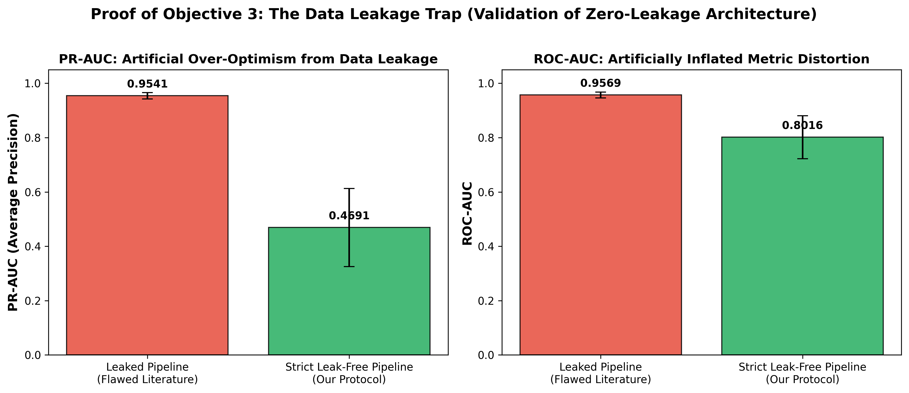

# Objective 3 — The Data-Leakage Trap and Our Leak-Free Test Setup

> **Presenter:** ______  **Time:** ~4 min
> **Status:** ✅ Done. Four **real** datasets, one notebook each (see [11](11_notebook_walkthrough_cell_by_cell.md)),
> a 25% locked test set plus 10 cross-validation rounds, and an automatic leakage test. Not done: tuning settings
> in an inner loop ("nested" CV); see [08](08_status_and_roadmap.md).
> **Research question (RQ3):** *Does SHAP-guided oversampling really beat normal SMOTE when there is
> **no data leakage**?*

---

## 1. What this objective is

A result is only worth something if the test was fair. This objective builds the **test
setup**: the machinery that runs every method × every model × every dataset the same way, with
**no chance for test data to leak into training**. It also **proves the trap is real** by showing
how much a leaky setup inflates scores.

---

## 2. The trap: making fake rows before you split

### The wrong way (common in published papers)
```
ALL DATA ──► SMOTE on everything ──► split into train / test ──► train ──► test
                    │
                    └── fake rows are built FROM test rows, then land in TRAINING.
                        The model has effectively seen the test answers.
```

**Why it inflates scores:** a fake training row built between test row *A* and training row *B*
sits very close to *A*. At test time, the model has in effect already seen *A*. It's like studying
from a copy of the exam.

On top of that, after SMOTE on everything, about **half the test set is fake** rare rows. You're
grading the model on fake, easy, balanced data instead of the real, rare, messy cases.

### The right way (our pipeline)
```
ALL DATA ──► split ──► TRAINING PART ──► scale → SHAP → make fake rows → train
                  └──► TEST PART (untouched, real class balance) ──► predict ──► score
```

### Proof from real research (see [01](01_problem_case_studies_novelty.md))
- **Preterm-birth studies:** Vandewiele et al. (2021) re-ran 11 studies. The near-perfect results
  only appear when oversampling is done before splitting.
- **Kapoor & Narayanan (2023):** found leakage in 294 papers across 17 fields. "Preparing train and
  test data together" is one of their named leakage types.

---

## 3. Our own proof: same data, same model, only the order changes



| Setup | PR-AUC | ROC-AUC |
|---|---:|---:|
| ❌ **Leaky:** scale and make fake rows on all data, then split | **0.954** | **0.957** |
| ✅ **Leak-free:** split first, everything else inside the training part | 0.469 | 0.802 |

*(Source: [scripts/generate_proof_and_kaggle_benchmarks.py](../scripts/generate_proof_and_kaggle_benchmarks.py).
Data: 600 made-up rows, 15 features, 90:10 imbalance, SHAP-Weighted SMOTE, Random Forest, 5 folds.)*

> **Slide headline:** *"Same data, same method, same model. Doing the steps in the wrong order
> **doubles** the PR-AUC, from 0.47 to 0.95. The 'great' result is fake."*

### A second, more extreme run (plain SMOTE, rarer class)

| Model | Setup | PR-AUC | Rare-class recall | Rare-class F1 |
|---|---|---:|---:|---:|
| Random Forest | ❌ Leaky | **0.999** | **0.984** | **0.983** |
| Random Forest | ✅ Leak-free | 0.207 | 0.173 | 0.212 |
| Logistic Regression | ❌ Leaky | **0.826** | **0.799** | **0.783** |
| Logistic Regression | ✅ Leak-free | 0.190 | 0.604 | 0.158 |

*(Data: 2,000 made-up rows, 20 features, 97:3 imbalance, 2% wrong labels, 5 folds. Script in
[07](07_running_the_system.md#5-proof-of-trap-script). One run on 2026-10-28.)*

**Why the gap is so big (two effects stacked):**
1. **Leak:** fake training rows are built from test rows.
2. **Fake test set:** in the leaky setup, half the test set is fake and easy. The leak-free test part
   has the real rare-class share (3%), and that's where PR-AUC is honestly low.

---

## 4. The leak almost everyone misses: SHAP itself

In our methods, SHAP is **learned** from data. If the scout model and SHAP were run on the whole
dataset:
- the feature weights would have seen the test labels, and
- the Filtered version would pick features using test-set knowledge.

That's the classic "choosing features before splitting" mistake, hidden inside an explainability step.

**Our rule:** the scout model, SHAP and the weights are all computed **inside `fit_resample`, on the
training part only**. Every fold gets its own fresh weights.

---

## 5. How the setup is built

### 5.1 `LeakFreePipeline` (one fold)
```python
pipe = LeakFreePipeline(oversampler=SHAPWeightedSMOTE(random_state=42),
                        classifier=LogisticRegression(solver="liblinear"))
pipe.fit(X_train, y_train)        # scale + SHAP + fake rows + train, on training rows only
pipe.predict_proba(X_test)        # apply the training scaling, then predict
```

| Step | Learned from | Used on the test part? |
|---|---|---|
| ① Scaling | training part | Applied only, using the training averages |
| ② Scout model + SHAP + weights | training part | ❌ never |
| ③ Making fake rows | training part | ❌ never (the test part keeps its real balance) |
| ④ Final model | balanced training part | Used to predict |

### 5.2 Running all folds
- **Stratified folds:** each fold keeps the real rare-class share. Without this, a fold could end up
  with zero rare test rows when the rare class is tiny.
- **Repeated folds:** shuffle and repeat to see how much results vary.
- **Fixed random seeds** everywhere, so the same command gives the same numbers.

### 5.3 The four-dataset benchmark (the main results)
Notebooks `01`–`04` run the same experiment on four **real** datasets. Each notebook:

1. Locks away a **25% test set** (same rare-class share as the full data). It is never resampled and is used once,
   at the very end.
2. Runs **2 × 5-fold cross-validation** on the other 75%. In every one of the 10 rounds, a **fresh** preparation
   step, sampler and model are fitted on the training part only, then scored on the untouched validation part.
3. Fits everything once more on the full 75% and scores it on the locked test set.

| What | Values |
|---|---|
| Datasets (4) | Breast Cancer (9.2:1), **real** Credit Card Fraud (582:1), Stroke (19.5:1), **real** NSL-KDD network attacks (11.5:1) |
| Methods (6) | No Sampling, Random Oversampling, SMOTE, Borderline-SMOTE, **SHAP-Filtered**, **SHAP-Weighted** |
| Models (3) | Logistic Regression, Random Forest, XGBoost |
| Rounds | 10 cross-validation rounds + 1 locked test set |

That's 4 × 6 × 3 = 72 combinations, each trained 11 times. Results: [12](12_results_breast_cancer.md)–[16](16_cross_dataset_notebook.md).

**Extra leakage protection in the new notebooks:**
- Missing-value filling and turning categories into 0/1 columns are also learned from training rows only (the
  Stroke and NSL-KDD data need both).
- An automatic test (`tests/test_experiment_pipeline.py`) checks, round by round, that every sampler receives
  exactly the training rows and never a single validation row.
- Every fake row is saved with its two parent rows; a check confirms that **no parent ever comes from the test set**.

### 5.4 The earlier benchmark (simulated data)
[experiments/run_benchmark.py](../experiments/run_benchmark.py) runs everything listed in
[benchmark_default.yaml](../experiments/configs/benchmark_default.yaml). It was built first and still uses
simulated credit-fraud and network data:

| What | Values |
|---|---|
| Oversamplers (9) | No balancing, Random copying, SMOTE, Borderline-SMOTE, ADASYN, SMOTE-ENN, SMOTE-Tomek, **SHAP-Filtered**, **SHAP-Weighted** |
| Models (3) | Logistic Regression, Random Forest, XGBoost |
| Datasets (4) | Synthetic (18:1), Breast cancer (9:1), Credit fraud simulation (49:1), Network intrusion simulation (11:1) |
| Folds | 5 |

That's 9 × 3 × 4 = **108 combinations**, each run over 5 folds. The results are in
[experiments/results/](../experiments/results/) and discussed in [06](06_objective4_evaluation_stability.md) §6.1.

---

## 6. How we guarantee "no leakage" (talking points)

1. **By design.** The oversampler is only ever called from `LeakFreePipeline.fit`, which only ever
   receives training rows. There is no code path that passes test rows to it.
2. **Scaling.** `predict` only *applies* the scaling learned from training data. It never re-learns it.
3. **SHAP.** SHAP runs inside `fit_resample`, so it gets the same protection as point 1.
4. **The test part stays real.** It's never resampled, so we score on the true, imbalanced data.
5. **Tested automatically.** `tests/test_experiment_pipeline.py` proves the samplers (and therefore SHAP) only
   ever receive training rows, and that the preparation steps learn from training rows only.
6. **Traceable.** All 1.28 million saved fake rows rebuild exactly from their two parents, and none of those
   parents is a test row.

---

## 7. Done vs still to do

| Item | Status |
|---|---|
| Leak-free fold pipeline (scale → SHAP → oversample → model) | ✅ |
| Repeated stratified folds, averages and spreads | ✅ |
| Proof of the trap (figure 2, and the table above) | ✅ |
| Four real datasets: Breast Cancer, Credit Card Fraud (real, 0.17% fraud), Stroke, NSL-KDD (real) | ✅ |
| Locked 25% test set + 10 cross-validation rounds, same settings for every dataset | ✅ |
| Fresh preparation step, sampler and model in every round | ✅ |
| Automatic leakage test | ✅ |
| Every fake row saved with its parents; no parent from the test set | ✅ |
| Earlier benchmark runner (YAML config, CSV/JSON/LaTeX, charts) | ✅ |
| **Nested** CV (an inner loop that tunes k and the threshold) | ⏳ not done |

---

## 8. One-slide summary

> *"Make fake rows before the split and you're grading the model on copies of its own homework. We
> showed the score doubles from 0.47 to 0.95 just by doing the steps in the wrong order. In our
> pipeline, the scaler, SHAP and the oversampler only ever see training data. The test data stays
> real, untouched and imbalanced. That's the only fair test."*
