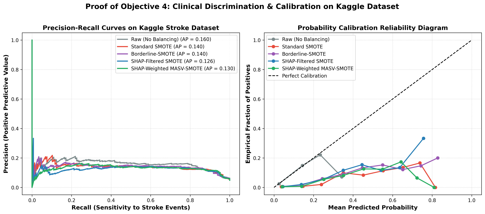
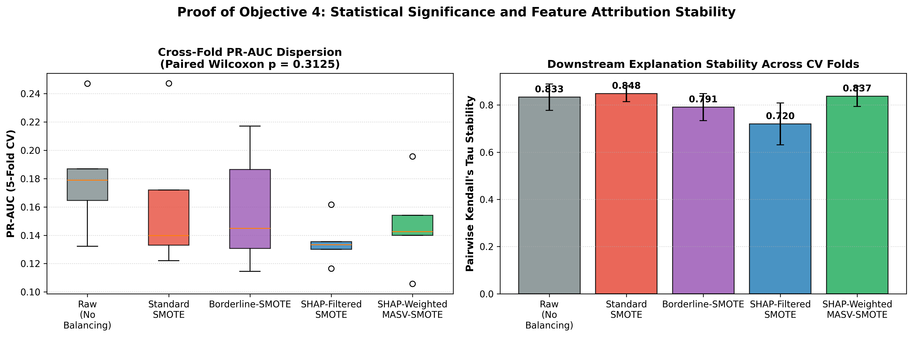
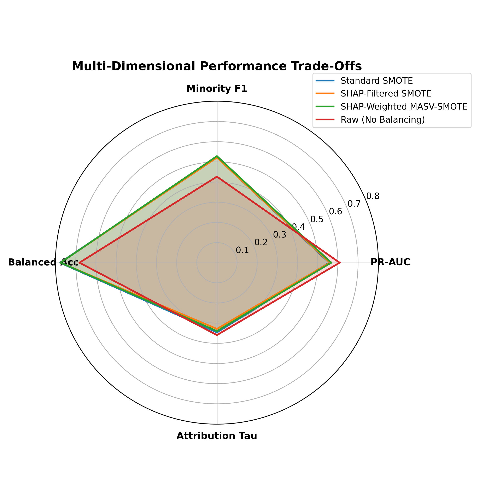
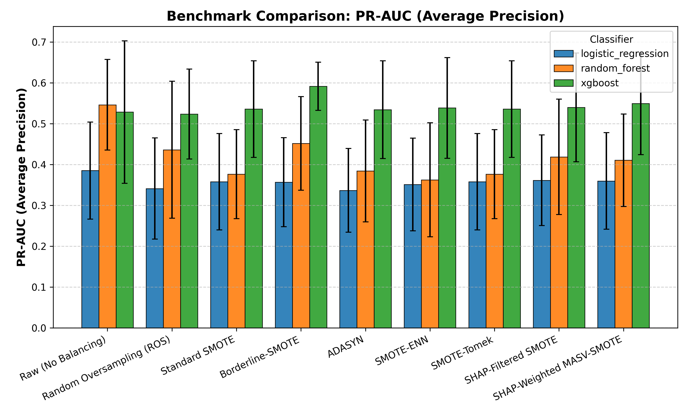
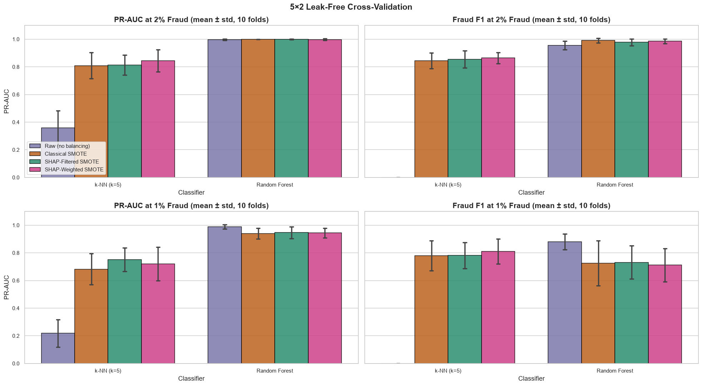

# Objective 4 — Four Ways to Score a Model, and What the Results Show

> **Presenter:** ______  **Time:** ~4 min
> **Status:** ✅ Done. All four groups of scores are measured on four real datasets, with Wilcoxon tests per
> dataset and a Friedman test across datasets. Not done: the Nemenyi follow-up chart.
> Code: [metrics.py](../src/evaluation/metrics.py), [fidelity.py](../src/evaluation/fidelity.py), [stability.py](../src/evaluation/stability.py)
> **Research question (RQ4):** *Does SHAP-guided oversampling change how stable the explanations are,
> how honest the probabilities are, and how realistic the fake rows are?*

---

## 1. What this objective is

One number can't tell you if a rare-event model is good. The Epic sepsis model had a respectable
headline score and still missed most sepsis cases. So we score every method on **four separate
questions**:

```
                                   THE SCOREBOARD
                                         │
       ┌──────────────────┬──────────────┴────────┬─────────────────────┐
       ▼                  ▼                       ▼                     ▼
 1. CATCHING RARE    2. HONEST              3. STABLE              4. REALISTIC
    CASES               PROBABILITIES          EXPLANATIONS           FAKE DATA
 "Do we catch it?"   "Can we trust the %?"  "Same story every      "Do fake rows look
                                             time we retrain?"      like real ones?"
 PR-AUC ★            ECE                    Kendall τ              Wasserstein distance
 Recall, Precision   Brier score            Spearman ρ             KS-test pass rate
 F1, G-mean                                                        Correlation similarity
```

---

## 2. Question 1: Do we catch the rare cases?

| Score | Plain meaning | Why we use it |
|---|---|---|
| **PR-AUC** ★ main score | How well the model ranks rare cases above common ones, focusing on the alarms it raises | Much more honest than ROC-AUC when the rare class is tiny. A random guess scores about the rare-class share (e.g. 0.03), not 0.5. |
| ROC-AUC | A ranking score that looks at all cases | Reported for comparison, but it can look good even when most alarms are false |
| Recall | "Of the real frauds, how many did we catch?" | Missing fraud is expensive |
| Precision | "Of our alarms, how many were real?" | Too many false alarms and people stop listening |
| F1 | A balance of recall and precision in one number | A quick summary |
| G-mean | Combines how well both classes are caught | Drops to 0 if *either* class is ignored |
| Balanced accuracy | Accuracy that isn't fooled by imbalance | Fairer than plain accuracy |

> **Talking point:** *"On a 0.17% fraud dataset, a model that does nothing is 99.83% accurate. Its
> PR-AUC is about 0.0017. PR-AUC can't be fooled that way."*

---

## 3. Question 2: Are the probabilities honest?

**Why it matters:** oversampling changes the balance the model sees. It learns that "about half of
all cases are fraud", so its probabilities get **inflated**. People make decisions on those numbers
("block the card if fraud > 90%"), so they need to mean what they say.

| Score | Plain meaning | Reading |
|---|---|---|
| **ECE** (calibration error) | Group predictions into 10 buckets, then compare "what the model said" with "what really happened" in each bucket | 0 is perfect. "When it says 70%, is it really 70%?" |
| **Brier score** | The average squared gap between the predicted probability and the real outcome | Lower is better |



*Right panel: the dashed diagonal is "perfectly honest". The grey line (no balancing) stays close to
it at low probabilities. Every oversampler sits well below it, which means their probabilities are
too high.*

---

## 4. Question 3: Are the explanations stable? ★ what makes our project different

**The question:** if we retrain the model on a slightly different slice of data, does it still say
the same features matter? If not, its explanations are partly noise. That matters to regulators,
doctors, and anyone who reads a SHAP chart and acts on it.

**How we measure it:**
1. For each fold, ask SHAP which features the final model relied on, and rank the features.
2. Compare the rankings between every pair of folds (with 5 folds, that's 10 pairs):
   - **Kendall τ:** how many feature *pairs* are in the same order in both rankings. Strict.
   - **Spearman ρ:** a gentler version that tolerates small swaps.
3. Report the average.

| Value | Meaning |
|---|---|
| τ ≈ 1 | Same ranking every fold. Explanations are reliable. |
| τ ≈ 0 | The rankings are basically random between folds. |
| τ < 0 | The rankings are reversed (a serious warning sign). |



*Right panel, stroke data: plain SMOTE 0.848, SHAP-Weighted 0.837, SHAP-Filtered 0.720. Left panel:
the paired Wilcoxon test gives p = 0.31, so the PR-AUC difference between SHAP-Weighted and SMOTE is
**not statistically significant**.*

> **Why this is new:** most oversampling papers only report prediction scores. Asking *"does the
> balancing method make explanations more or less trustworthy?"* is rarely measured, and it links
> directly to the Dutch-benefits story in [01](01_problem_case_studies_novelty.md).

---

## 5. Question 4: Do the fake rows look real?

**Function:** `compute_synthetic_fidelity(real_rare_rows, fake_rare_rows)` in [fidelity.py](../src/evaluation/fidelity.py)

For each feature it compares real rare rows with fake ones:
- **Wasserstein distance:** how much you'd have to "move" one distribution to turn it into the other.
  Lower = more alike.
- **KS test:** a statistical test of whether two samples could come from the same distribution. A
  feature "passes" if we can't tell them apart.
- **Correlation similarity:** whether the links *between* features are kept. 1 = perfectly kept.
- **Detectability** *(added in the four-dataset notebooks)*: we train a model to tell real rare rows from fake
  ones. 0.5 = it can't (the fake rows look real); 1.0 = it always can. The test is split so that a fake row is never
  checked against its own parents.
- **Common-class neighbours** *(also new)*: for each fake row, the share of its 5 closest real rows that belong to
  the common class. High = fake rows land in the wrong territory.

The notebooks save all of these for every method (cell 23, see [11](11_notebook_walkthrough_cell_by_cell.md)).

---

## 6. Results

### 6.0 Main results: four real datasets (notebooks 01–05)
Every number is an average over 10 leak-free cross-validation rounds. Full details: [12](12_results_breast_cancer.md),
[13](13_results_credit_card.md), [14](14_results_stroke.md), [15](15_results_nsl_kdd.md), [16](16_cross_dataset_notebook.md).

**Catching rare cases (PR-AUC and F1):** no method is significantly better overall (Friedman test: PR-AUC p = 0.056,
F1 p = 0.107). Average rank over 4 datasets × 3 models (1 = best):

| Method | PR-AUC rank | F1 rank |
|---|---|---|
| Random Oversampling | **2.50** | 2.75 |
| No Sampling | 2.75 | **2.67** |
| **SHAP-Filtered SMOTE** | 3.29 | 3.25 |
| **SHAP-Weighted SMOTE** | 3.75 | 4.33 |
| SMOTE | 4.29 | 3.75 |
| Borderline-SMOTE | 4.42 | 4.25 |

**SHAP-guided vs plain SMOTE, dataset by dataset:**

| Dataset | Result |
|---|---|
| Breast Cancer | No real difference |
| Credit Card Fraud | **Better** with tree models: XGBoost F1 +0.025 and precision +0.02 (significant); same frauds caught |
| Stroke | **Worse** with tree models: recall roughly halved in every round (significant). Cause: the category columns (see [14](14_results_stroke.md)) |
| NSL-KDD | No practical difference (all differences below 0.01) |

**Honest probabilities (ECE, lower is better):** oversampling makes probabilities less honest on three datasets:
Credit Card (≤ 0.001 without oversampling vs up to 0.086 with), Stroke (≤ 0.017 vs up to 0.28) and NSL-KDD
(≤ 0.016 vs up to 0.12). Breast Cancer is the exception (all about 0.02–0.04).

**Stable explanations (Kendall τ):** the SHAP methods are about as stable as SMOTE or slightly less (averaged over the three models: 0.62–0.82 vs SMOTE's 0.65–0.83). Borderline-SMOTE is the
least stable on Breast Cancer and Credit Card.

**Realistic fake data:**

| Dataset | Detectability: SMOTE | SHAP-Filtered | SHAP-Weighted | Borderline-SMOTE |
|---|---|---|---|---|
| Breast Cancer | 0.53 | 0.52 | 0.54 | 0.76 |
| Credit Card Fraud | 0.56 | 0.58 | 0.58 | 0.78 |
| Stroke | 0.81 | **0.93** | **0.96** | 0.77 |
| NSL-KDD | 0.87 | 0.88 | 0.88 | 0.97 |

SMOTE and our methods make realistic fake rows on all-numeric data. On Stroke, our methods' fake patients get
impossible "half-categories" and become easy to spot. Borderline-SMOTE is the least realistic almost everywhere.

### 6.1 Earlier benchmark: 9 methods × 3 models × 4 datasets (partly simulated data)
Source: [experiments/results/BENCHMARK_REPORT.md](../experiments/results/BENCHMARK_REPORT.md). Averages over all datasets and models.

| Method | PR-AUC | F1 | Balanced acc. | ECE ↓ | Stability τ | Wasserstein ↓ | KS pass | Time (s) |
|---|---:|---:|---:|---:|---:|---:|---:|---:|
| No balancing | **0.609** | 0.427 | 0.682 | **0.024** | **0.359** | 0 | 100% | **1.9** |
| Random copying | 0.576 | 0.499 | 0.741 | 0.116 | 0.335 | 0.91 | 100% | 2.2 |
| Borderline-SMOTE | 0.575 | 0.512 | 0.756 | 0.096 | 0.345 | 7.40 | 82% | 2.5 |
| **SHAP-Weighted** | 0.567 | **0.528** | 0.775 | 0.127 | 0.339 | 1.64 | 99% | 3.7 |
| **SHAP-Filtered** | 0.560 | 0.521 | 0.776 | 0.128 | 0.329 | 1.62 | 100% | 3.7 |
| Standard SMOTE | 0.557 | 0.522 | 0.779 | 0.127 | 0.346 | 1.27 | 100% | 2.1 |
| SMOTE-Tomek | 0.557 | 0.522 | 0.779 | 0.127 | 0.346 | 1.38 | 100% | 2.6 |
| ADASYN | 0.556 | 0.507 | 0.768 | 0.130 | 0.343 | 7.64 | 88% | 2.6 |
| SMOTE-ENN | 0.553 | 0.510 | **0.801** | 0.169 | 0.345 | 1.64 | 100% | 2.6 |




More charts from the same run: [F1](../experiments/results/figures/f1_score_comparison.png),
[calibration (ECE)](../experiments/results/figures/ece_calibration_comparison.png),
[explanation stability](../experiments/results/figures/attribution_stability_comparison.png).

**What this shows, honestly:**
- **SHAP-Weighted has the best F1** of all methods, and both SHAP versions edge out plain SMOTE on
  PR-AUC. The margins are tiny (about 0.01), well inside the fold-to-fold spread.
- **Not balancing has the best PR-AUC, calibration and stability.** Oversampling mainly buys
  **recall and F1** (catching more rare cases) and costs **honest probabilities**: ECE goes from
  about 0.02 to about 0.13.
- **Realistic fake data:** the SMOTE-family methods (including ours) keep the data realistic (KS pass
  99–100%). Borderline-SMOTE and ADASYN do worst (Wasserstein above 7).
- **Cost:** the SHAP versions take about 1.8× as long as plain SMOTE.

### 6.2 Credit card fraud simulation (from the archived notebook)
From [notebooks/archive/02_credit_fraud_shap_smote_walkthrough.ipynb](../notebooks/archive/02_credit_fraud_shap_smote_walkthrough.ipynb), 5 folds × 2 repeats:



| Fraud rate | Model | No balancing | SMOTE | SHAP-Filtered | SHAP-Weighted |
|---|---|---:|---:|---:|---:|
| 2% | k-NN, PR-AUC | 0.358 | 0.809 | 0.814 | **0.844** |
| 1% | k-NN, PR-AUC | 0.218 | 0.682 | **0.751** | 0.720 |
| 1% | Random Forest, F1 | **0.880** | 0.725 | 0.732 | 0.711 |

- With a **distance-based model (k-NN)**, the SHAP versions consistently beat plain SMOTE. The gain is
  largest when fraud is rarest.
- With **Random Forest**, oversampling of any kind *hurts* at 1% fraud.

### 6.3 Small demo (`scripts/demo_benchmark.py`, run 2026-10-28)
500 made-up rows, 15 features (5 useful), 448:52 imbalance, 5 folds.

| Method | Model | PR-AUC | ROC-AUC | F1 | ECE ↓ | τ |
|---|---|---:|---:|---:|---:|---:|
| No balancing | LogReg | 0.769 | 0.909 | 0.703 | **0.048** | **0.764** |
| No balancing | RF | 0.806 | 0.929 | 0.624 | 0.060 | 0.722 |
| SMOTE | LogReg | 0.761 | 0.891 | 0.582 | 0.138 | 0.695 |
| SMOTE | RF | **0.849** | **0.958** | 0.737 | 0.129 | **0.829** |
| SHAP-Filtered | LogReg | 0.762 | 0.896 | 0.610 | 0.122 | 0.726 |
| SHAP-Filtered | RF | 0.828 | 0.953 | **0.786** | 0.126 | 0.752 |
| SHAP-Weighted | LogReg | 0.754 | 0.896 | 0.604 | 0.122 | 0.711 |
| SHAP-Weighted | RF | 0.834 | 0.944 | 0.739 | 0.124 | 0.760 |

---

## 7. The honest overall verdict

- **There's no clear winner.** On four real datasets, no method is significantly better than the others on
  PR-AUC or F1. *Not oversampling at all* is the most frequent winner (7 of 12 dataset + model combinations by F1).
- **SHAP guidance is situational.** It beats plain SMOTE with tree models on credit-card fraud (fewer false
  alarms), makes no difference on breast cancer and network attacks, and clearly hurts on stroke (mixed number and
  category data).
- **SHAP-Filtered is the safer variant**: it ranks above plain SMOTE on both PR-AUC and F1.
- **On the simulated data**, SHAP helped most with a **distance-based** model (k-NN on 1% fraud: PR-AUC
  0.68 → 0.75). k-NN is not yet part of the four-dataset benchmark.
- **Oversampling usually makes probabilities less honest** (three of four datasets).
- **Say on stage:** *"Our pipeline gives a fair, leak-free answer: SHAP guidance helps in some situations, not
  all, and we can show exactly why it fails where it fails. That is a useful result in itself."*

**How to read one row out loud:** *"PR-AUC: how well we rank the rare cases. F1: the balance between
catching cases and false alarms. ECE: how honest the probabilities are, lower is better. τ: how
consistent the explanations are between folds, closer to 1 is better."*

---

## 8. Still to do

| Item | Why |
|---|---|
| Nemenyi follow-up and a critical-difference chart | The standard picture for "which methods differ" across datasets |
| More repeats (5×5 folds) | Smaller error bars and more powerful tests |
| Add k-NN to the four notebooks | The simulation suggested SHAP helps distance-based models most |

---

## 9. One-slide summary

> *"We don't just ask 'is it more accurate?'. We ask four questions: does it catch more rare cases
> (PR-AUC, recall), are its probabilities honest (ECE), are its explanations stable (Kendall τ), and
> are the fake rows realistic (Wasserstein, KS)? A method only really wins if it wins on more than one."*
