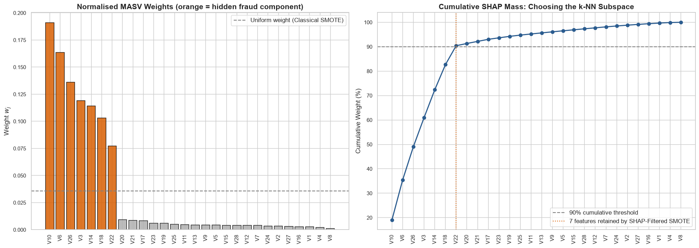
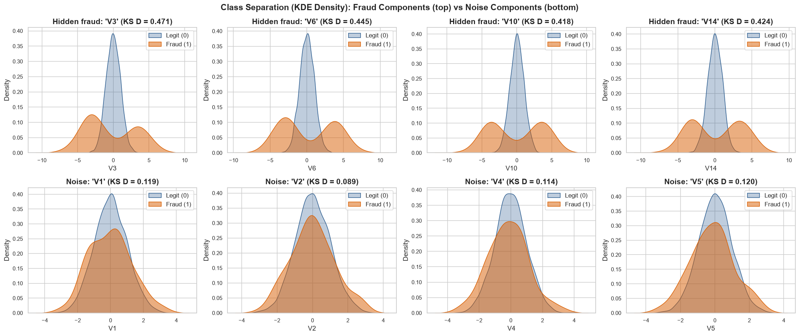
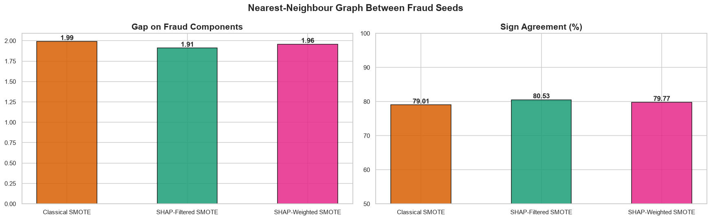
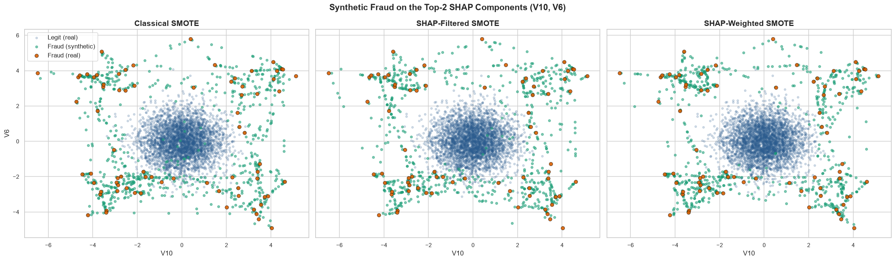
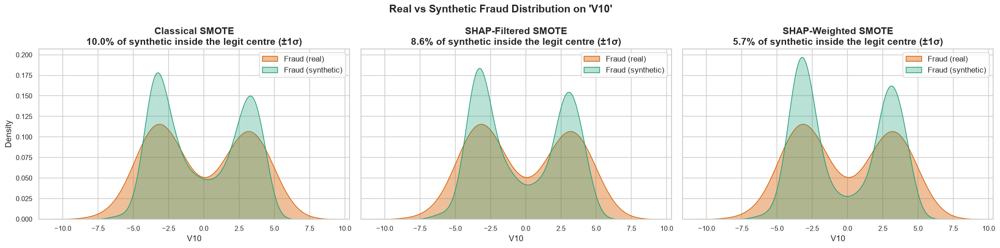
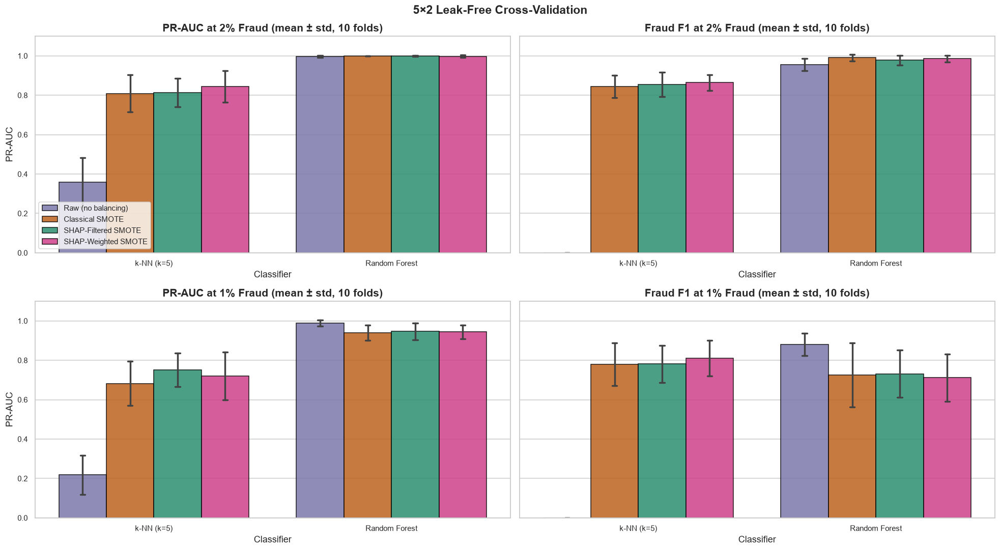
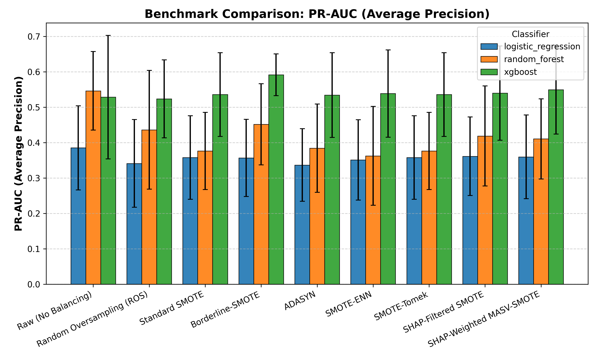
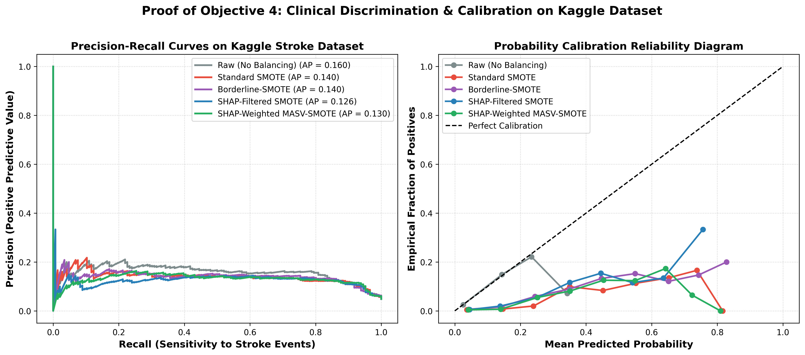
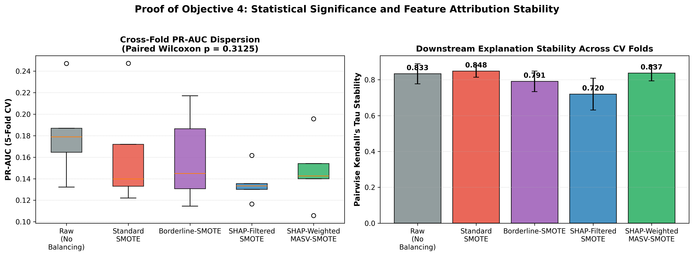

# 10 — SHAP-Filtered SMOTE: What It Is, How It Works, and How It Did

> **Who should read this:** the Objective 2 presenter, and anyone who gets asked
> "what does your method actually do?"
> **Code:** [src/oversampling/shap_filtered_smote.py](../src/oversampling/shap_filtered_smote.py)
> **Live walkthrough:** [notebooks/archive/02_credit_fraud_shap_smote_walkthrough.ipynb](../notebooks/archive/02_credit_fraud_shap_smote_walkthrough.ipynb)

---

## 1. In one sentence

**SHAP-Filtered SMOTE is normal SMOTE, except that it ignores unimportant features when it
looks for "similar" rows.** SHAP decides which features are important.

---

## 2. The problem it fixes

**SMOTE** makes fake rows for the rare class (for example, fraud) so the model has more
examples to learn from. To make one fake row, it:

1. picks a real fraud row,
2. finds the fraud rows that look most **similar** to it (its "neighbours"),
3. picks a random point on the line between the row and one neighbour. That point is the new row.

The weak spot is step 2. Plain SMOTE measures "similar" using **every feature equally**. If
most of the features are random noise, the noise decides who counts as a neighbour. SMOTE
then pairs up the wrong rows, and the fake rows land in the wrong places.

> **Everyday example:** you want to find people with the same taste in films, but you compare
> them on 30 things, and 25 of those (shoe size, phone colour…) have nothing to do with films.
> You'll match the wrong people. SHAP-Filtered SMOTE first asks "which of these 30 things
> actually matter for film taste?" and compares people only on those.

---

## 3. How it works, step by step

```
TRAINING DATA ONLY (the test data is never touched)
        │
        ▼
 ① Train a small "scout" model (Random Forest, 50 trees, depth 5)
        │
        ▼
 ② Ask SHAP: "how much did each feature help spot the rare class?"
        │      → one importance score per feature (they add up to 100%)
        ▼
 ③ Sort features from most to least important.
    Keep adding features until they cover 90% of the total importance.   ← the "filter"
        │
        ▼
 ④ Find each rare row's 5 nearest rare neighbours, using ONLY the kept features
        │
        ▼
 ⑤ Make new rows exactly like normal SMOTE: a random point on the line
    between a row and one of its neighbours, using ALL features
        │
        ▼
 Original rows + new fake rows  →  the final model is trained on this
```

**Two points to stress:**
- The filter is only used to **choose neighbours** (step ④). The new rows still have **every
  column** (step ⑤). No data is deleted.
- Steps ① to ③ run on the **training data only**, again inside every cross-validation fold.
  If SHAP saw the test data, the method would be cheating (see [05](05_objective3_leak_free_benchmark_trap.md)).

### What it looks like on real numbers (credit card fraud simulation)

The simulation has 28 features. Only 7 of them actually carry the fraud signal; the other 21
are noise. SHAP was not told which 7 are real, yet it found all of them:



- **Left:** importance of each feature. Orange = a real fraud feature, grey = noise. The 7
  real ones hold **90.4%** of the importance. The dashed line is what plain SMOTE uses (every
  feature gets the same 1/28 share).
- **Right:** importance added up feature by feature. The curve passes 90% exactly at the 7th
  feature, so SHAP-Filtered SMOTE keeps those **7 features** and drops the 21 noise ones from
  the neighbour search.

---

## 4. The settings (one of three ways to choose the features)

| Setting | What it means | Example |
|---|---|---|
| `cumulative_threshold=0.90` **(default)** | Keep the most important features until they cover 90% of the total importance | 28 features → 7 kept (credit fraud) |
| `top_k=5` | Keep exactly the top 5 features | always 5 |
| `top_ratio=0.25` | Keep the top 25% of features (rounded up) | 28 features → 7 kept |

Other settings: `k_neighbors=5` (how many neighbours to look at) and
`sampling_strategy="auto"` (make as many fake rows as needed to reach a 1:1 balance).

**Safety check:** with `cumulative_threshold=1.0`, every feature is kept, so the method
**turns back into plain SMOTE**. So any difference from SMOTE comes only from the filter.

```python
from src.oversampling import SHAPFilteredSMOTE

sm = SHAPFilteredSMOTE(cumulative_threshold=0.90, k_neighbors=5, random_state=42)
X_new, y_new = sm.fit_resample(X_train, y_train)

sm.feature_weights_           # importance of each feature (adds up to 1)
sm.selected_feature_indices_  # which features were kept for the neighbour search
```

---

## 5. What it changes in the data (credit card fraud example)

All of this comes from the notebook
[02_credit_fraud_shap_smote_walkthrough.ipynb](../notebooks/archive/02_credit_fraud_shap_smote_walkthrough.ipynb).
The data has 5,000 transactions with 2% fraud, and the training part has **75 real fraud rows**.

### 5.1 The fraud is split into two groups

On every real fraud feature, fraud sits in two clumps: one at about +3 and one at about −3.
Normal transactions sit in the middle. The noise features look the same for both classes.



This matters for SMOTE: if it pairs a "+3" fraud with a "−3" fraud, the new row lands near 0,
which is the middle of the **normal** transactions. That is a bad fake row.

### 5.2 Better neighbours



| | Plain SMOTE | SHAP-Filtered |
|---|---:|---:|
| Average gap between neighbours on the 7 fraud features (lower = more alike) | 1.99 | **1.91** |
| Neighbour pairs on the **same side** (+3 or −3) | 79.0% | **80.5%** |

The neighbours are a bit more alike. The improvement is **small**, because in this data the
fraud signal is already strong enough for plain SMOTE to pick mostly sensible neighbours.

### 5.3 Where the fake rows land



Blue = normal, orange = real fraud, green = fake fraud. Compare how many green points fall
into the blue centre.



On the most important feature (V10), the share of fake fraud that lands in the "normal" zone
(between −1 and +1):

| Plain SMOTE | SHAP-Filtered | SHAP-Weighted |
|---:|---:|---:|
| 10.0% | **8.6%** | 5.7% |

### 5.4 Do the fake rows look real?

| Check | Plain SMOTE | SHAP-Filtered |
|---|---:|---:|
| Fake rows that an independent "oracle" model calls **normal** (label noise, lower = better) | **3.19%** | 3.44% |
| Average distance between real and fake distributions (Wasserstein, lower = better) | 0.219 | **0.218** |
| Features whose fake values pass the "same distribution" test (KS) | 100% | 100% |
| How well the links between features are kept (correlation similarity, 1 = perfect) | 0.939 | **0.944** |

**Honest reading:** both methods make realistic fake fraud. SHAP-Filtered is slightly better on
three of these four checks and slightly worse on the oracle check. These differences are tiny.

---

## 6. Benchmarking: how well did it do?

Every result below uses the **leak-free** setup (see [05](05_objective3_leak_free_benchmark_trap.md)):
SHAP, scaling and oversampling only ever see the training data.

### 6.0 Four real datasets (the main benchmark, notebooks 01–05)

Average over 10 cross-validation rounds; ★ = significantly different from plain SMOTE (Wilcoxon, p < 0.05).

| Dataset | Features SHAP-Filtered keeps | Model | PR-AUC: SMOTE → SHAP-Filtered | F1: SMOTE → SHAP-Filtered |
|---|---|---|---|---|
| Breast Cancer | 17 of 30 | Logistic Regression | 0.962 → 0.962 | 0.878 → 0.872 |
| | | Random Forest | 0.927 → 0.922 | 0.869 → 0.878 |
| | | XGBoost | 0.922 → 0.927 | 0.829 → 0.841 |
| Credit Card Fraud | 13 of 29 | Logistic Regression | 0.729 → 0.724 | 0.103 → 0.105 |
| | | Random Forest | 0.736 → **0.756 ★** | 0.488 → 0.517 |
| | | XGBoost | 0.808 → 0.811 | 0.392 → **0.417 ★** |
| Stroke | 10 of 21 | Logistic Regression | 0.190 → 0.192 | 0.226 → 0.223 |
| | | Random Forest | 0.153 → 0.155 | 0.205 → 0.182 (recall 0.62 → **0.23 ★**) |
| | | XGBoost | 0.151 → 0.162 | 0.173 → 0.139 (recall 0.20 → **0.11 ★**) |
| NSL-KDD | 23 of 116 | Logistic Regression | 0.976 → 0.976 | 0.877 → 0.876 |
| | | Random Forest | 0.995 → 0.995 | 0.969 → 0.972 |
| | | XGBoost | 0.999 → 0.999 | 0.992 → 0.992 |

**Reading it:**
- **Credit-card fraud** (all-numeric, extremely rare) is where SHAP-Filtered helps: better ranking with Random
  Forest and fewer false alarms with XGBoost (precision +0.022, significant), with the same frauds caught.
- **Breast cancer and network attacks:** no real difference; plain SMOTE's neighbours were already good.
- **Stroke** (numbers + categories): the tree models catch far fewer strokes. The filter drops the low-importance
  category columns from the neighbour search, so patients from different categories get paired, and the fake
  patients end up with impossible in-between category values. See [14](14_results_stroke.md).
- **Overall** (average rank over 4 datasets × 3 models, 1 = best): SHAP-Filtered 3.29 on PR-AUC and 3.25 on F1,
  better than plain SMOTE (4.29 and 3.75) and better than SHAP-Weighted (3.75 and 4.33), but behind *no
  oversampling* and random oversampling. None of these overall differences is statistically significant.

### 6.1 Earlier result: credit card fraud **simulation** (5 folds × 2 repeats)



| Fraud rate | Model | Metric | No balancing | Plain SMOTE | **SHAP-Filtered** |
|---|---|---|---:|---:|---:|
| 2% | k-NN | PR-AUC | 0.358 | 0.809 | **0.814** |
| 2% | k-NN | F1 | 0.000 | 0.845 | **0.854** |
| 2% | Random Forest | F1 | 0.955 | **0.990** | 0.978 |
| 1% | k-NN | PR-AUC | 0.218 | 0.682 | **0.751** |
| 1% | k-NN | F1 | 0.000 | 0.779 | **0.781** |
| 1% | Random Forest | F1 | **0.880** | 0.725 | 0.732 |

- **k-NN** (a model that works purely on distances) gains the most. At 1% fraud, PR-AUC goes
  from 0.68 to **0.75**. The fold-to-fold spread is about ±0.09, so this is a real trend but
  **not proven**.
- **Random Forest** is already almost perfect here, and at 1% fraud *any* oversampling makes it
  worse than no balancing at all.

### 6.2 Earlier benchmark: 4 datasets × 3 models (partly simulated data)

Source: [experiments/results/benchmark_results.csv](../experiments/results/benchmark_results.csv).
Each number is the average over the 3 models.

| Dataset | Imbalance | PR-AUC: no balancing | PR-AUC: SMOTE | PR-AUC: **SHAP-Filtered** | F1: SMOTE | F1: **SHAP-Filtered** |
|---|---|---:|---:|---:|---:|---:|
| Synthetic (20 features) | 18:1 | **0.487** | 0.423 | 0.440 | 0.395 | 0.395 |
| Breast cancer (medical) | 9:1 | **0.955** | 0.953 | **0.955** | **0.877** | 0.867 |
| Credit fraud simulation | 49:1 | **0.708** | 0.648 | 0.642 | **0.573** | 0.565 |
| Network intrusion simulation | 11:1 | **0.285** | 0.203 | 0.203 | 0.241 | **0.259** |

Overall averages (from [BENCHMARK_REPORT.md](../experiments/results/BENCHMARK_REPORT.md)):

| | PR-AUC | F1 | Explanation stability (Kendall τ) | Time per run |
|---|---:|---:|---:|---:|
| Plain SMOTE | 0.557 | **0.522** | **0.346** | **2.1 s** |
| SHAP-Filtered SMOTE | **0.560** | 0.521 | 0.329 | 3.7 s |



**Honest reading:**
- SHAP-Filtered and plain SMOTE are **roughly tied**. Each wins some cells by a small margin.
- **Not balancing at all** often has the best PR-AUC. Oversampling mainly helps **recall and
  F1** (catching more of the rare cases), and it costs calibration.
- SHAP-Filtered is about **1.8× slower** than SMOTE, because of the extra scout model and SHAP step.

### 6.3 Earlier stroke result (older pipeline; the four-dataset result in §6.0 replaces it)




In these figures SHAP-Filtered has the **lowest PR-AUC** (0.126 vs 0.140 for SMOTE and 0.160
for no balancing) and the **lowest explanation stability** (τ = 0.720 vs 0.848 for SMOTE).
A likely reason: the stroke data has only 11 clinical features, and most of them matter. Cutting
features to reach 90% of the importance throws away useful information. That is exactly the
"risk" listed in §7.

---

## 7. When does it help, and when doesn't it?

| ✅ Works well when… | ❌ Struggles when… |
|---|---|
| Many features are pure noise (it cuts them out cleanly) | Most features carry some signal (cutting loses information, as in the stroke data) |
| The final model relies on distances (k-NN, SVM) | The final model is a strong tree ensemble that already ignores noise |
| The rare class is very rare (1%), so each neighbour choice matters more | Features only matter **in combination**: a feature that looks weak on its own can get cut |
| You want to **show** which features drove the oversampling (`selected_feature_indices_`) | You need the fastest possible pipeline |
| All features are numbers (credit-card fraud) | The data has **category columns** that get cut from the search, so fake rows get in-between category values (stroke) |

**Strengths:** simple to explain ("ignore the noise"), cuts noise completely, easy to inspect,
and turns into plain SMOTE when the threshold is 1.0.

**Weaknesses:** a hard yes/no cut, sensitive to the threshold, depends on the scout model being
good, slower than SMOTE, and works for two classes and numeric features only.

---

## 8. SHAP-Filtered vs SHAP-Weighted in one table

| | **SHAP-Filtered** | SHAP-Weighted |
|---|---|---|
| Idea | **Mute button**: a feature is either in or out | Volume dial: every feature counts, scaled by its importance |
| Features used to find neighbours | Only the top features (e.g. 7 of 28) | All 28, each stretched by √(importance) |
| Features used to build new rows | All | All |
| Extra setting | The threshold (default 90%) | None |
| Best when | Lots of pure-noise features | The signal is spread over many features |
| Credit fraud simulation, 1% fraud, k-NN PR-AUC | **0.751** | 0.720 |
| Four real datasets: average PR-AUC rank (1 = best) | **3.29** | 3.75 |
| Four real datasets: average F1 rank | **3.25** | 4.33 |
| Real credit-card fraud, XGBoost F1 vs SMOTE | +0.025 ★ | +0.025 ★ |
| Real stroke, Random Forest recall vs SMOTE | −0.39 ★ | −0.36 ★ |

Full details of SHAP-Weighted are in [04](04_objective2_shap_guided_smote.md).

---

## 9. Likely questions

**Q: Doesn't dropping features lose information?**
> Only for the neighbour search. Every new row still has all its columns. But yes, if a dropped
> feature was actually useful, neighbours get chosen less well. That's what we see on the stroke data.

**Q: Why 90%?**
> It's a sensible default that keeps most of the signal and drops the long tail of near-zero
> features. On the credit fraud data, 90% landed exactly on the 7 real features. It should be
> tuned per dataset. Tuning it inside an inner cross-validation loop is on the roadmap.

**Q: Isn't it cheating to pick features with SHAP?**
> It would be if SHAP saw the test data. Here SHAP is computed again inside each training fold,
> on training rows only.

**Q: So does it beat SMOTE?**
> Sometimes. On four real datasets it beats SMOTE with tree models on credit-card fraud, ties on breast cancer
> and network attacks, and loses on stroke because of the category columns. Overall it ranks above plain SMOTE,
> but not significantly. On the earlier simulation it helped a distance-based model (k-NN on 1% fraud: 0.68 →
> 0.75 PR-AUC). We report all of it.

---

## 10. One-slide summary

> *"SHAP-Filtered SMOTE asks SHAP which features matter, keeps the ones that make up 90% of the
> importance, and uses only those to decide which rare rows are neighbours. On simulated fraud data it found
> all 7 real fraud features out of 28. On four real datasets it is the better of our two methods: it beats plain
> SMOTE on real credit-card fraud, ties on two datasets, and hurts on stroke, where cutting the category columns
> from the search creates unrealistic fake patients."*
